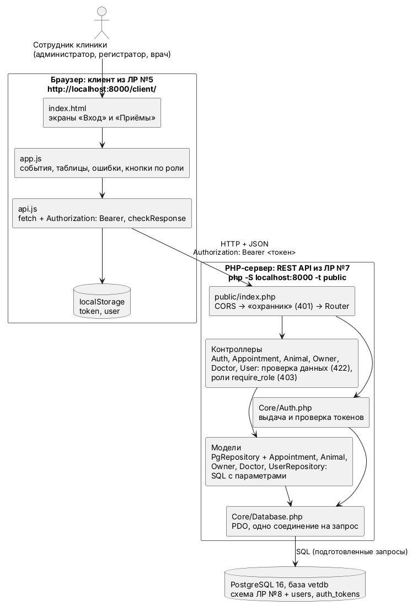
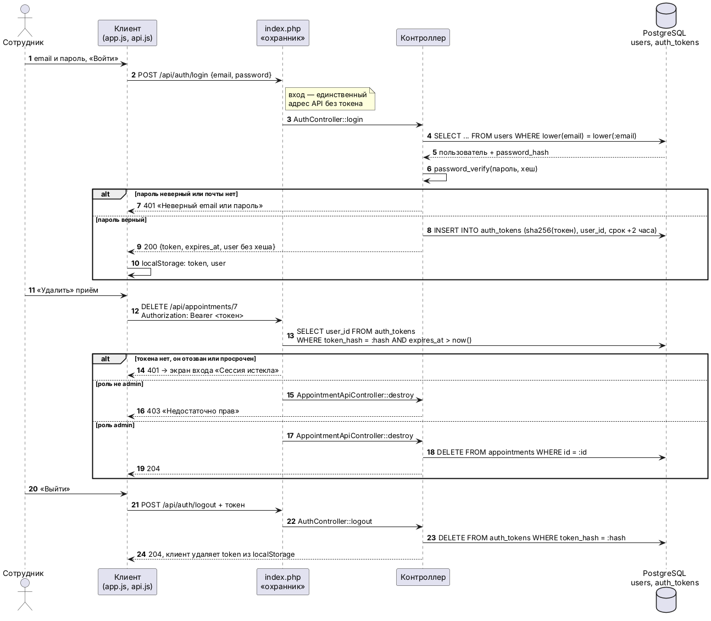
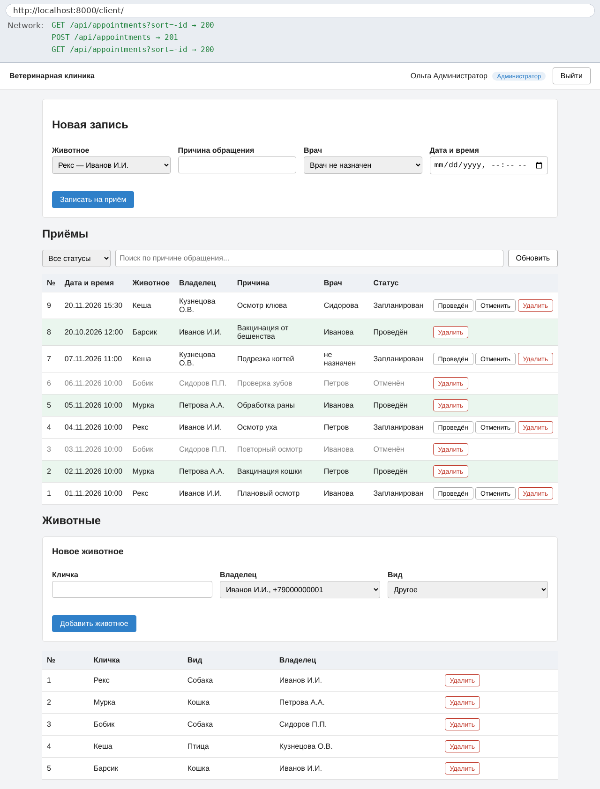
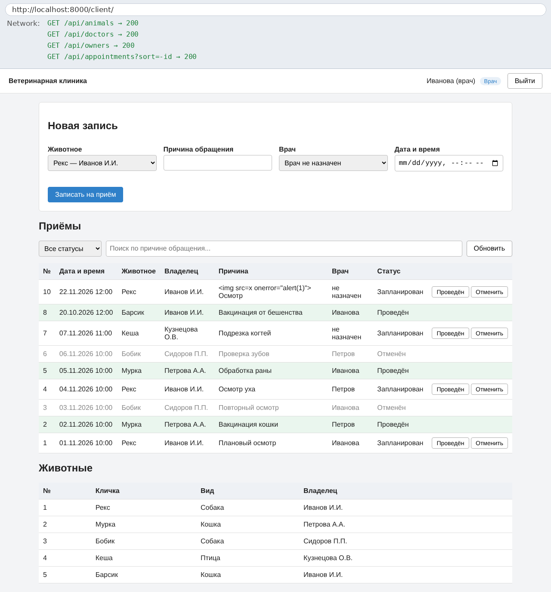
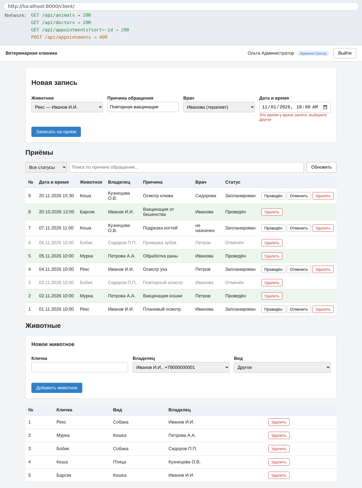
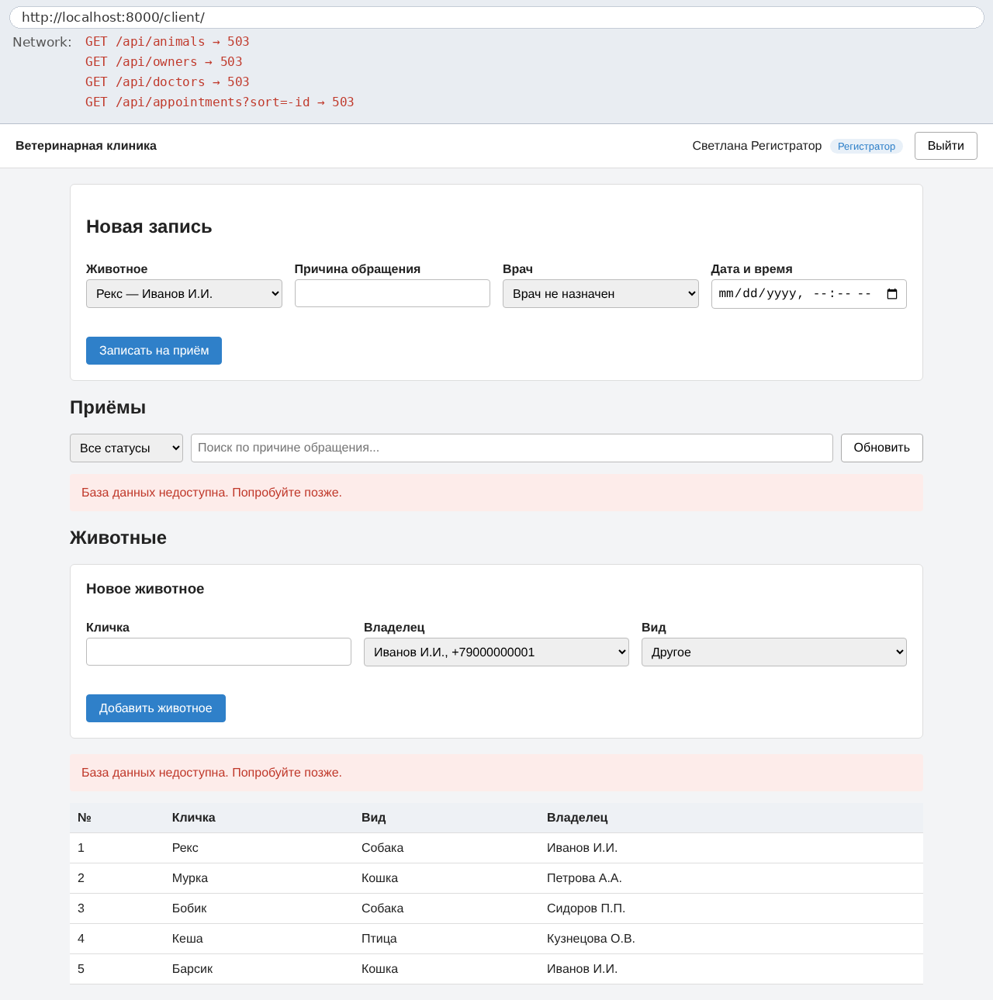
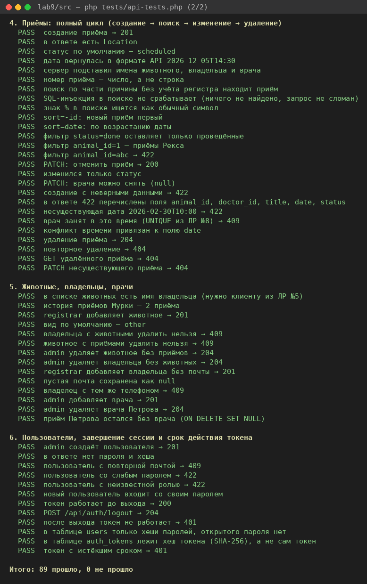
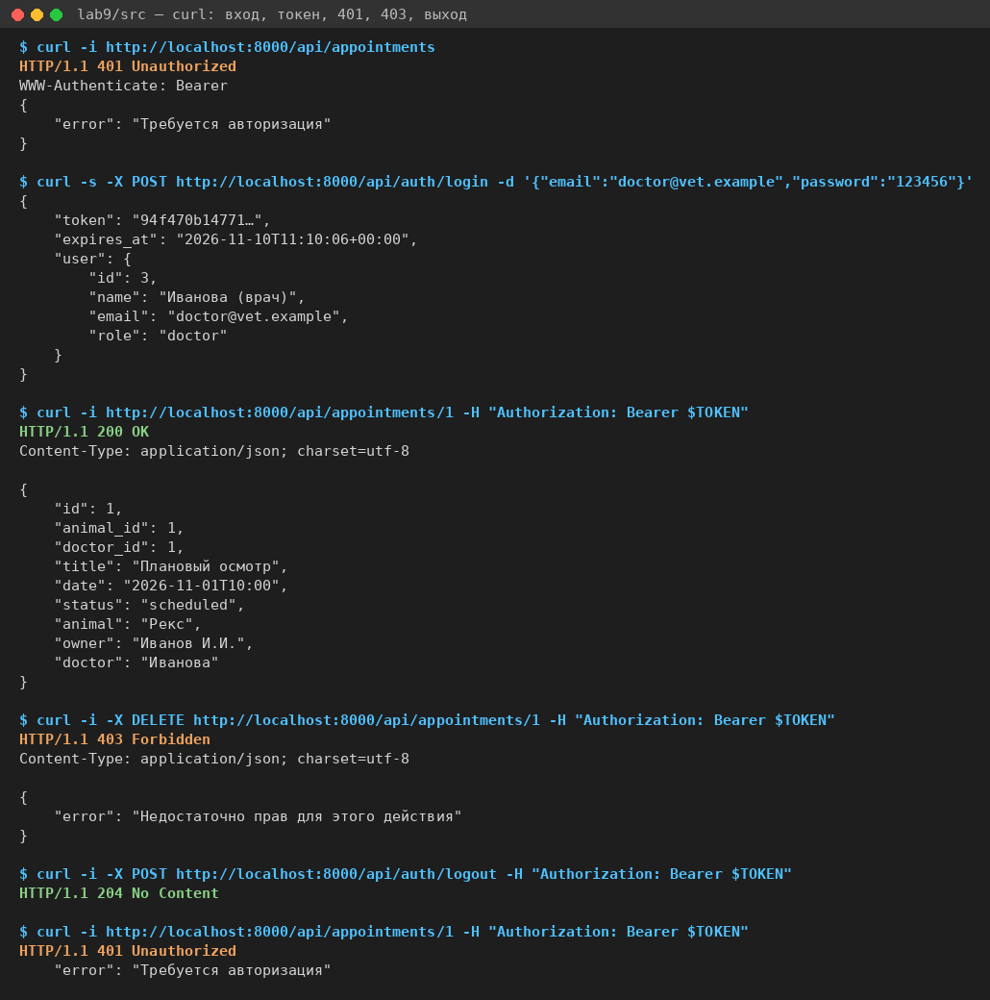
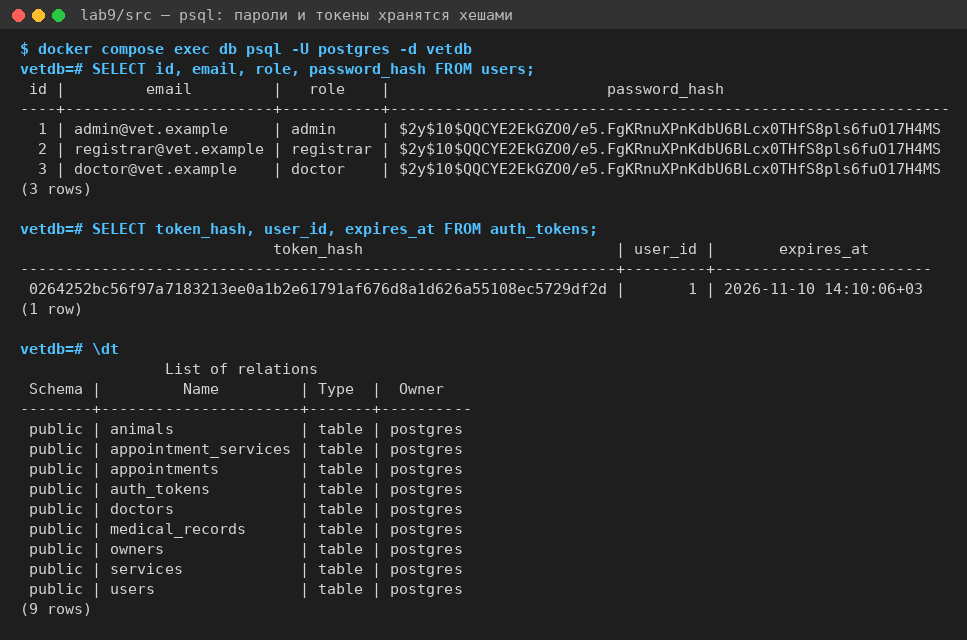

# Лабораторная работа №9
Выполнили - Парфенова Екатерина и Елена Ярмуш
## Интеграция компонентов веб-приложения

## Цель работы

Объединить клиент (ЛР №5), REST API (ЛР №7) и базу данных PostgreSQL (ЛР №8) системы «Ветеринарная клиника» в одно приложение, добавить вход по паролю с ролями, пройти полный пользовательский сценарий и выполнить комплексное тестирование.

## Что сделано

1. **Пример «Задачи команды».** По заготовке выполнены все 11 заданий TODO, их решение сохранено в истории Git отдельными коммитами («ЛР №9, часть 1» … «части 3–5»):
   - подготовленные запросы `find` и `delete`;
   - вход, «охранник», роль для удаления, ответ без хеша пароля;
   - сортировка и кодирование адреса, поле `due_date`, ошибки из `errors`;
   - возврат ко входу при 401, кнопка «Удалить» только руководителю;
   - 7 своих автотестов (61 из 61 PASS).
2. **Перенос на ветклинику.** Сервер переведён с JSON-файлов на базу `vetdb` со схемой из ЛР №8. Добавлены пользователи системы с ролями, к API подключён клиент из ЛР №5, `mock-api.js` больше не используется.
3. **Тестирование.** 89 автотестов API, 20 сквозных сценариев в браузере, 8 проверок безопасности: всё проходит.

## Запуск

Нужны Docker, PHP 8.2+ с расширением `pdo_pgsql`, браузер.

```sh
cd lab9/src
docker compose up -d                                  # PostgreSQL 16, база vetdb
php bin/reset-db.php                                  # таблицы и тестовые данные
PHP_CLI_SERVER_WORKERS=4 php -S localhost:8000 -t public
```

Клиент открывается по адресу http://localhost:8000/client/. Автотесты запускаются во втором окне терминала: `php tests/api-tests.php`.

Если порт 5432 занят базой ЛР №8, остановите её (`docker compose down` в папке lab8) или запустите на другом порту: `DB_PORT=5433 docker compose up -d`, и передайте `DB_PORT=5433` серверу, `reset-db.php` и тестам. В Windows PowerShell переменная задаётся так: `$env:DB_PORT=5433`. Режим `PHP_CLI_SERVER_WORKERS` в Windows не работает, сервер запускается без него.

| Пользователь | Пароль | Роль |
|---|---|---|
| admin@vet.example | 123456 | admin — администратор |
| registrar@vet.example | 123456 | registrar — регистратор |
| doctor@vet.example | 123456 | doctor — врач |

Пароли `123456` и пароль базы `secret` учебные. В рабочей системе они хранятся вне репозитория.

## Как устроена интеграция



[Исходник схемы](diagrams/src/integration.puml)

| Компонент | Что делает | Файлы |
|---|---|---|
| клиент | экраны «Вход» и «Приёмы»: запись на приём, список с поиском и фильтром, животные; хранит токен в localStorage | `src/public/client/` |
| api.js | все запросы к серверу: заголовок `Authorization`, проверка `response.ok`, ошибки с кодом и полями | `src/public/client/js/api.js` |
| index.php | точка входа: CORS, «охранник» (401 для всего API, кроме входа), маршрутизатор; ошибки базы 23505/23503 → 409 | `src/public/index.php` |
| контроллеры | проверка данных (422), роли `require_role` (403), ответы JSON; SQL не содержат | `src/app/Controllers/Api/` |
| модели | единственное место с SQL: `PgRepository` (all, find, add, update, delete) из заготовки без изменений и модели ветклиники | `src/app/Models/` |
| Database | одно соединение PDO на запрос; база недоступна → 503 | `src/app/Core/Database.php` |
| PostgreSQL | таблицы ЛР №8 (владельцы, животные, врачи, приёмы, медзаписи, услуги) + `users` и `auth_tokens` | `src/sql/schema.sql`, `src/sql/seed.sql` |

Замена хранилища почти не затронула остальные слои. Модели ЛР №7 работали с JSON-файлами (`JsonRepository`), теперь у них общий родитель `PgRepository` с теми же пятью операциями. Все значения передаются в SQL параметрами (`:id`, `:q`). Имя столбца для сортировки параметром передать нельзя, поэтому оно выбирается из списка допустимых (`AppointmentRepository::search`).

Модель приёмов ([AppointmentRepository.php](src/app/Models/AppointmentRepository.php)) возвращает данные в формате API ЛР №7 прямо из SQL:

```php
protected string $columns = "id, animal_id, doctor_id, title,
    to_char(scheduled_at, 'YYYY-MM-DD\"T\"HH24:MI') AS date, status,
    (SELECT a.name FROM animals a WHERE a.id = appointments.animal_id) AS animal, ...";
```

## Авторизация



[Исходник схемы](diagrams/src/login-flow.puml)

- **Вход.** `POST /api/auth/login` ищет пользователя по почте и сверяет пароль функцией `password_verify` с хешем из `users.password_hash`. При ошибке ответ всегда один: 401 «Неверный email или пароль», чтобы нельзя было узнать, какие адреса зарегистрированы.
- **Токен.** 64 случайных символа (`random_bytes`), действует 2 часа. В таблице `auth_tokens` хранится только его SHA-256. Клиент отправляет токен в каждом запросе: `Authorization: Bearer <токен>`.
- **Охранник.** Стоит в `index.php`, в одном месте для всего API кроме входа. Нет токена, токен просрочен или отозван — 401.
- **Выход.** `POST /api/auth/logout` удаляет токен из базы: после этого он не действует, даже если его скопировали.
- **Хеш пароля** не попадает ни в один ответ: это делает функция `public_user()`.

| Действие | admin | registrar | doctor |
|---|---|---|---|
| смотреть приёмы, животных, владельцев, врачей | да | да | да |
| записывать на приём, менять приём (провести, отменить) | да | да | да |
| удалять приём | да | 403 | 403 |
| добавлять и изменять животных и владельцев | да | да | 403 |
| удалять животных и владельцев | да | 403 | 403 |
| врачи и пользователи системы | да | 403 | 403 |

На сервере право проверяется одной строкой в начале метода: `require_role('admin');`. Клиент по роли скрывает кнопки «Удалить» и форму «Новое животное», но это только удобство: прямой запрос врача `DELETE /api/appointments/1` сервер отклоняет с кодом 403 (сценарий D2).

Полное описание адресов, полей и ошибок: [docs/api.md](docs/api.md).

## Что пришлось согласовать между клиентом и сервером

| № | Расхождение | Как проявлялось | Решение |
|---|---|---|---|
| 1 | клиент ЛР №5 работал с `mock-api.js` | запросы не доходили до настоящего сервера | `mock-api.js` и `mock-data.js` отключены, все запросы идут через `api.js` с токеном |
| 2 | врач: в ЛР №5 и №7 строка `doctor`, в базе ЛР №8 таблица `doctors` | сервер ждёт номер, клиент шлёт текст — 422 | в приёме `doctor_id` (число или null), в форме список из `GET /api/doctors`; имя врача сервер отдаёт полем `doctor` только для чтения |
| 3 | «врач не назначен»: из `<select>` приходит `""` | 422 «Выберите врача из списка» | клиент отправляет `null` |
| 4 | номера из `<select>` — строки (`"4"`) | 422 по `animal_id` | клиент отправляет числа: `Number(...)` |
| 5 | время приёма: в API поле `date` вида `2026-11-01T10:00`, в базе столбец `scheduled_at` типа TIMESTAMP | PDO вернул бы `2026-11-01 10:00:00`, клиент показал бы дату неверно | сервер приводит формат в SQL (`to_char`), при записи меняет `T` на пробел |
| 6 | клиент ЛР №5 показывал в списке животных имя владельца (`owner`), а API ЛР №7 отдавал только `owner_id` | в списке «Рекс — undefined» | сервер добавляет `owner`, а в приёмы — `animal`, `owner`, `doctor` (подзапросы, только чтение) |
| 7 | пустая почта владельца: в ЛР №7 `""`, в базе NULL | | сервер сохраняет `""` как NULL и отдаёт `null` |
| 8 | формат ошибок: клиент ЛР №5 показывал общий текст, сервер присылает `errors` по полям | пользователь не видел, что исправить | клиент читает `errors` и показывает сообщения под полями (422), а занятое время врача — под полем «Дата и время» (409) |
| 9 | порядок списка: новый приём оказывался в конце | после записи приём «терялся» | клиент запрашивает `?sort=-id`, сервер понимает `sort=id`, `date`, `title` с минусом для убывания |
| 10 | поиск: значения в адресе не кодировались | русские буквы и знаки `& # +` ломали адрес | `encodeURIComponent` в клиенте; на сервере `ILIKE :q` с параметром, `%` и `_` экранируются |
| 11 | два приёма у врача в одно время: в ЛР №8 это запрещает `UNIQUE (doctor_id, scheduled_at)` | ошибка базы превращалась в 500 | сервер проверяет занятость заранее и отвечает 409; на случай гонки нарушения UNIQUE (23505) и внешнего ключа (23503) в `index.php` тоже превращаются в 409 |

## Полный пользовательский сценарий

| Шаг | Снимок |
|---|---|
| 1. Вход; неверный пароль — 401 | [01-login](images/01-login.png), [02-login-error](images/02-login-error.png) |
| 2. Список приёмов администратора, поиск и фильтр | [03-list-admin](images/03-list-admin.png), [14-empty](images/14-empty.png) |
| 3. Запись на приём: приём №9 первый в списке | [04-created](images/04-created.png) |
| 4. Ошибки сервера под полями: 422 и 409 | [05-error-422](images/05-error-422.png), [06-error-409](images/06-error-409.png) |
| 5. Провести и удалить приём; текст с тегами выводится как текст | [16-xss](images/16-xss.png) |
| 6. Выход, вход врачом: нет кнопок «Удалить»; прямой запрос — 403 | [07-list-doctor](images/07-list-doctor.png), [08-error-403](images/08-error-403.png) |
| 7. Истёкшая сессия, нет связи, база остановлена, сервер остановлен | [09](images/09-session-expired.png), [10](images/10-offline.png), [11](images/11-db-down.png), [12](images/12-server-down.png) |

Вверху каждого снимка указаны адрес страницы и последние запросы к API с кодами ответов из вкладки Network.









## Результаты тестирования

| Уровень | Количество | Результат |
|---|---|---|
| автотесты API (`tests/api-tests.php`) | 89 проверок в 6 группах | 89 PASS |
| сквозные сценарии в браузере | 20 (вход и выход, список, создание и удаление, роли, устойчивость) | все пройдены |
| проверки безопасности | 8 | все пройдены |

Таблицы сценариев с фактическими результатами: [docs/testing.md](docs/testing.md).







## Что ещё не готово к настоящей эксплуатации

- работа по HTTP; токен и пароль можно перехватить в сети, нужен HTTPS;
- пароль базы `secret` записан в `config/app.php` и `docker-compose.yml`, его нужно вынести в переменные окружения или в файл `.env` вне репозитория;
- нет миграций схемы: `schema.sql` удаляет и создаёт таблицы заново;
- нет ограничения попыток входа и журнала входов;
- токен хранится в localStorage, поэтому уязвим при XSS; надёжнее cookie с флагом HttpOnly;
- встроенный сервер PHP (`php -S`) предназначен только для разработки.

Из раздела «Повышенная сложность» выполнено одно задание: ошибки базы 23505 и 23503 превращаются в ответ 409 вместо 500.

## Вывод

Клиент, сервер и база ветеринарной клиники работают вместе: сотрудник входит по паролю, записывает животное на приём, видит список с поиском и фильтром и получает понятные сообщения при любой ошибке, от неверного поля до остановленной базы. Главной работой стала не новая логика, а согласование контракта: имена и типы полей, пустые значения, формат даты и ошибок, параметры списка. Каждое такое расхождение было видно во вкладке Network.

Защита построена на сервере: «охранник» требует токен для всего API, роли проверяются в контроллерах, пароли и токены хранятся в базе только хешами, SQL выполняется с параметрами. Всё это подтверждено 89 автотестами, 20 сценариями в браузере и проверками безопасности.

## Структура

```
lab9/
├── README.md
├── src/
│   ├── docker-compose.yml        PostgreSQL 16, база vetdb
│   ├── sql/                      schema.sql (ЛР №8 + users, auth_tokens), seed.sql
│   ├── bin/reset-db.php          вернуть базу к исходному состоянию
│   ├── config/app.php            параметры базы, срок токена, CORS
│   ├── public/index.php          CORS, «охранник», маршрутизатор
│   ├── public/client/            клиент: index.html, js/api.js, js/app.js
│   ├── app/                      Core (Database, Auth, Router), Controllers/Api, Models
│   ├── routes/web.php            маршруты API
│   └── tests/api-tests.php       автотесты API
├── diagrams/                     схемы интеграции и входа (PlantUML + картинки)
├── images/                       скриншоты сценария и тестов
└── docs/
    ├── api.md                    документация API с авторизацией
    └── testing.md                таблицы тестирования
```
