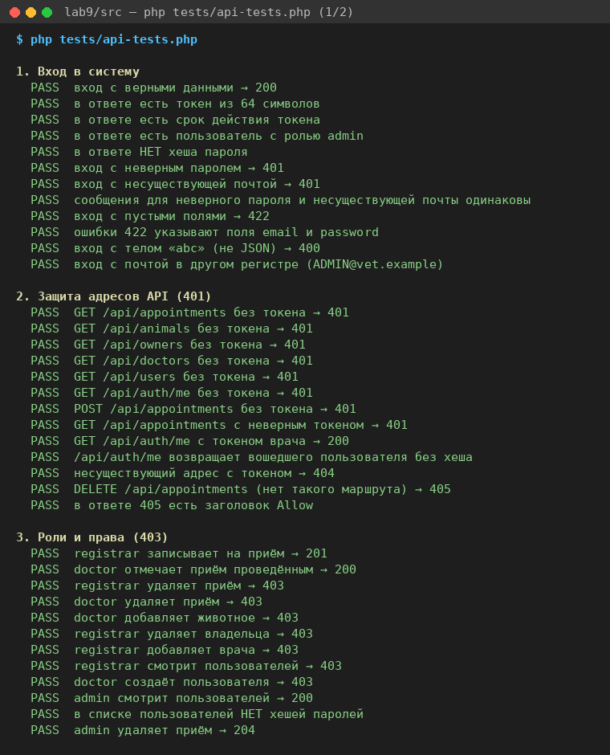
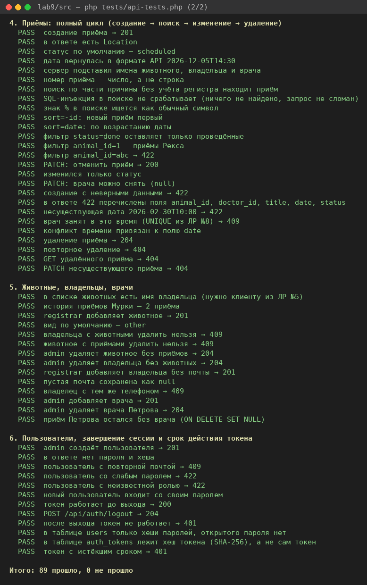

# Комплексное тестирование

Проверено 10 ноября 2026 года на PostgreSQL 16, PHP 8.3 и Chromium. Перед каждым прогоном база сбрасывалась командой `php bin/reset-db.php`. Пароль всех пользователей — `123456`.

Уровни тестирования:

| Уровень | Чем | Результат |
|---|---|---|
| автотесты API | `php tests/api-tests.php` | 89 проверок, все PASS |
| сквозные сценарии в браузере | таблицы ниже, 20 сценариев | все пройдены |
| проверки безопасности | прямые запросы, база данных, консоль | 8 проверок, все пройдены |

## 1. Автотесты API

Шесть групп проверок:
1. вход в систему;
2. защита адресов (401);
3. роли и права (403);
4. полный цикл приёма;
5. животные, владельцы, врачи;
6. пользователи, выход и срок токена.

В каждой группе есть позитивные проверки, например «вход с верными данными → 200», и негативные, например «registrar удаляет приём → 403». В конце тесты сами возвращают базу к исходному состоянию.

## 2. Сквозные сценарии

Ожидаемый результат записан до выполнения шагов. Столбец «Факт» — что показал браузер и вкладка Network.

### Вход и выход

| № | Сценарий | Шаги | Ожидаемый результат | Факт | Результат |
|---|---|---|---|---|---|
| A1 | Вход администратора | открыть http://localhost:8000/client/, «Войти» с `admin@vet.example` | экран приёмов, роль «Администратор», 8 приёмов; в Network `POST /api/auth/login → 200` и запросы списков с токеном → 200 | роль «Администратор», в таблице 8 приёмов | пройден |
| A2 | Неверный пароль | ввести пароль `000000`, «Войти» | под формой «Неверный email или пароль»; в Network ответ 401 | «Неверный email или пароль», `POST /api/auth/login → 401` ([снимок](../images/02-login-error.png)) | пройден |
| A3 | Выход и отзыв токена | запомнить токен из localStorage, «Выйти», затем запрос `GET /api/appointments` со старым токеном | экран входа, `token` удалён из localStorage; старый токен → 401 | экран входа, `token` = null; старый токен → 401 | пройден |

### Работа со списком

| № | Сценарий | Шаги | Ожидаемый результат | Факт | Результат |
|---|---|---|---|---|---|
| B1 | Поиск | ввести в поиск «осмотр» | через 0,3 с запрос `?sort=-id&q=...`; найдены 3 приёма (плановый, уха, повторный) | найдено 3 приёма | пройден |
| B2 | Фильтр по статусу | выбрать «Проведён» | только проведённые приёмы: 3 строки | 3 строки, у всех «Проведён» | пройден |
| B3 | Ничего не найдено | ввести в поиск «zzz» | таблица скрыта, сообщение «Приёмы не найдены…» | «Приёмы не найдены. Измените поиск или статус.» ([снимок](../images/14-empty.png)) | пройден |

### Создание, изменение, удаление

| № | Сценарий | Шаги | Ожидаемый результат | Факт | Результат |
|---|---|---|---|---|---|
| C1 | Запись на приём | Кеша, «Осмотр клюва», врач Сидорова, 20.11.2026 15:30, «Записать на приём» | `POST → 201`; приём №9 первый в списке, владелец Кузнецова О.В., врач Сидорова | строка «9 · 20.11.2026 15:30 · Кеша · Кузнецова О.В. · Осмотр клюва · Сидорова · Запланирован» ([снимок](../images/04-created.png)) | пройден |
| C2 | Ошибка 422 от сервера | в консоли подменить номер животного в списке на 999 и отправить форму | `POST → 422`; под полем «Животное» сообщение сервера | «Выберите животное из списка» под полем ([снимок](../images/05-error-422.png)) | пройден |
| C3 | Врач занят (409) | Иванова, 01.11.2026 10:00 (у неё уже приём) | `POST → 409`; под полем «Дата и время» сообщение о занятом времени | «Это время у врача занято, выберите другое» ([снимок](../images/06-error-409.png)) | пройден |
| C4 | Приём проведён | у приёма №9 нажать «Проведён» | `PATCH {"status":"done"} → 200`, статус «Проведён», строка зелёная | статус «Проведён» | пройден |
| C5 | Удаление приёма | у приёма №9 нажать «Удалить», подтвердить | `DELETE → 204`, приём исчез из списка | первая строка — приём №8, `DELETE /api/appointments/9 → 204` | пройден |
| C6 | Животное с приёмами | у Рекса нажать «Удалить» | `DELETE /api/animals/1 → 409`, сообщение сервера | «Нельзя удалить животное: у него есть приёмы» ([снимок](../images/17-animal-409.png)) | пройден |

### Роли

| № | Сценарий | Шаги | Ожидаемый результат | Факт | Результат |
|---|---|---|---|---|---|
| D1 | Интерфейс врача | войти как `doctor@vet.example` | нет кнопок «Удалить», нет формы «Новое животное»; кнопки «Проведён» и «Отменить» есть | кнопок «Удалить»: 0, форма скрыта ([снимок](../images/07-list-doctor.png)) | пройден |
| D2 | Прямой запрос врача на удаление | в консоли врача: `deleteAppointment(1)` | `DELETE /api/appointments/1 → 403`, приём не удалён | 403 «Недостаточно прав для этого действия» ([снимок](../images/08-error-403.png)) | пройден |
| D3 | Врач проводит приём | у приёма «Плановый осмотр» нажать «Проведён» | `PATCH → 200`, статус «Проведён» | статус «Проведён» | пройден |
| D4 | Регистратор | войти как `registrar@vet.example` | форма «Новое животное» видна, кнопок «Удалить» нет | так и есть | пройден |

### Устойчивость

| № | Сценарий | Шаги | Ожидаемый результат | Факт | Результат |
|---|---|---|---|---|---|
| E1 | Истёкшая сессия | в консоли `localStorage.setItem('token', 'bad')`, «Обновить» | запросы → 401; экран входа с «Сессия истекла. Войдите снова.» | так и есть ([снимок](../images/09-session-expired.png)) | пройден |
| E2 | Пропала связь | Network → Offline, «Обновить» | «Нет связи с сервером. Проверьте подключение и повторите.» | так и есть ([снимок](../images/10-offline.png)) | пройден |
| E3 | База недоступна (503) | `docker compose stop db`, «Обновить» | запросы → 503, «База данных недоступна. Попробуйте позже.»; после `docker compose start db` список загружается снова | так и есть ([снимок](../images/11-db-down.png)) | пройден |
| E4 | Сервер остановлен | остановить `php -S` (Ctrl+C), «Обновить» | «Нет связи с сервером…», а не пустая страница | так и есть ([снимок](../images/12-server-down.png)) | пройден |

## 3. Проверки безопасности

| № | Проверка | Как проверяли | Результат |
|---|---|---|---|
| S1 | Пароли в таблице users — только хеши | `SELECT email, password_hash FROM users` и автотест | у всех `$2y$10$…`, открытого пароля нет ([снимок](../images/21-database.png)) — пройден |
| S2 | Ответы API не содержат password_hash | автотесты: ответ входа, `/api/auth/me`, `/api/users`, создание пользователя | хеша и пароля в ответах нет — пройден |
| S3 | Без токена данных нет | `curl -i http://localhost:8000/api/appointments` и автотесты для 6 адресов | 401 «Требуется авторизация» ([снимок](../images/20-curl-auth.png)) — пройден |
| S4 | Скрытая кнопка не заменяет проверку на сервере | врач отправляет `DELETE /api/appointments/1` через curl и из консоли | 403, приём на месте — пройден |
| S5 | Текст с тегами выводится как текст | приём с причиной ` Осмотр` | в ячейке виден текст с угловыми скобками, тегов `img` в таблице 0, окно alert не появилось ([снимок](../images/16-xss.png)) — пройден |
| S6 | SQL-инъекция в поиске не срабатывает | `GET /api/appointments?q=' OR 1=1 --` | 200 и пустой список: строка ищется как текст — пройден |
| S7 | В auth_tokens лежит хеш токена | автотест сравнивает строку в базе с `hash('sha256', токен)` | хранится только SHA-256 — пройден |
| S8 | Токен с истёкшим сроком не работает | автотест сдвигает `expires_at` на час назад | 401 — пройден |

## 4. Что не прошло с первого раза

- **Автотест «врача можно снять (null)»** выдавал FAIL при правильной работе сервера. Ошибка была в самом тесте: `($r['json']['doctor_id'] ?? 0) === null` — оператор `??` заменяет null на 0. Проверку переписали через `array_key_exists`.
- **Сообщение при удалении животного с приёмами** в первой версии клиента дублировалось: «Не удалось удалить: Нельзя удалить животное…». В `describeError` добавили ветку для 409: сервер сам объясняет конфликт, клиент показывает его текст как есть.
- **Поле поиска** сжималось до нескольких пикселей: глобальное правило `input { width: 100% }` спорило с `flex` в панели фильтров. Для `.toolbar` задали `width: auto`.
