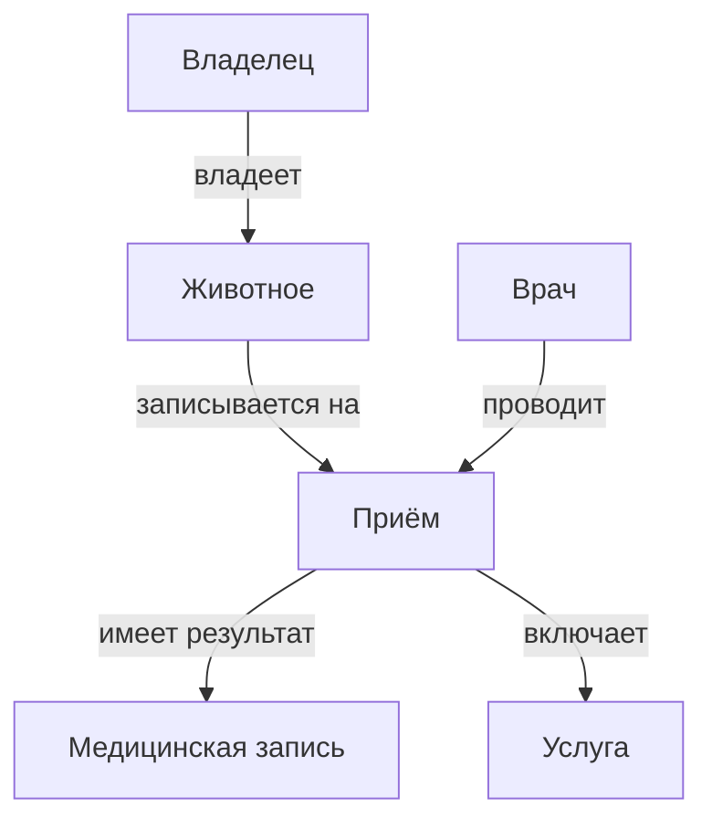

# Лабораторная работа №1
## Анализ предметной области информационной системы

Вариант 21. Система управления ветеринарной клиникой.
За основу взята работа Парфеновой Екатерины и Ярмуш Елены.

## Цель работы

Описать предметную область, определить пользователей, основные объекты и требования к системе.

## 1. Описание предметной области

Система нужна для учёта владельцев животных, животных, врачей, приёмов и медицинских записей. Администратор записывает клиентов на приём, а врач сохраняет результаты осмотра и назначения.

## 2. Проблема и цель системы

Проблема: запись ведётся по телефону и в бумажном журнале. Данные хранятся в разных местах, из-за чего сложно найти историю лечения и следить за расписанием.

Цель: объединить сведения о клиентах, животных и приёмах в одной системе.

Область применения: ветеринарная клиника.

## 3. Объекты предметной области

| Объект | Назначение | Основные характеристики |
|---|---|---|
| Владелец | Человек, которому принадлежит животное | ФИО, телефон, электронная почта |
| Животное | Пациент клиники | Кличка, вид, порода, пол, возраст, вес |
| Врач | Проводит приёмы | ФИО, специальность, телефон, график работы |
| Приём | Запись животного к врачу | Дата, время, статус, причина обращения |
| Медицинская запись | Результаты приёма | Жалобы, диагноз, назначения |
| Услуга | Работа, выполненная на приёме | Название, стоимость |

Владелец может иметь несколько животных. У животного может быть несколько приёмов. Каждый приём проводит один врач. Медицинская запись относится к одному приёму. На приёме могут быть назначены услуги.

## 4. Пользователи и роли

| Роль | Основные действия |
|---|---|
| Владелец животного | Смотрит данные своего животного и историю лечения |
| Администратор | Регистрирует владельцев и животных, записывает на приём, переносит и отменяет записи |
| Ветеринарный врач | Смотрит расписание и историю лечения, создаёт и редактирует медицинские записи, назначает услуги |
| Руководитель | Смотрит отчёты о работе клиники |

## 5. Функциональные требования

- FR-01. Система должна позволять администратору регистрировать владельца с указанием ФИО и телефона.
- FR-02. Система должна позволять добавлять животное и связывать его с владельцем.
- FR-03. Система должна обеспечивать запись животного к врачу на выбранные дату и время.
- FR-04. Система должна позволять администратору переносить приём.
- FR-05. Система должна позволять администратору отменять приём.
- FR-06. Система должна показывать расписание врача.
- FR-07. Система должна позволять врачу просматривать карточку животного и историю лечения.
- FR-08. Система должна позволять врачу создавать медицинскую запись.
- FR-09. Система должна позволять врачу редактировать медицинскую запись.
- FR-10. Система должна позволять врачу назначать услуги на приём.
- FR-11. Система должна обеспечивать поиск владельцев, животных и приёмов.

## 6. Концепция системы

Система представляет собой веб-приложение. Пользователь работает через браузер. Сервер обрабатывает запросы, а база данных хранит информацию. Владелец видит только своих животных, врач работает с медицинскими записями, администратор ведёт запись на приём, руководитель просматривает отчёты. При записи система может отправить владельцу письмо.

## 7. Схема предметной области

[Исходник схемы](diagrams/subject-area.mmd) · [Файл для редактирования](diagrams/subject-area.drawio) · [Изображение](images/subject-area.svg).

## 8. Вывод

Описана предметная область ветеринарной клиники. Определены объекты, роли пользователей и основные требования к системе.
