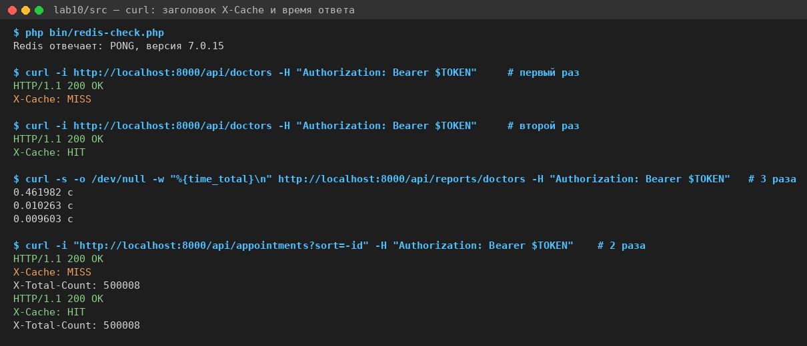
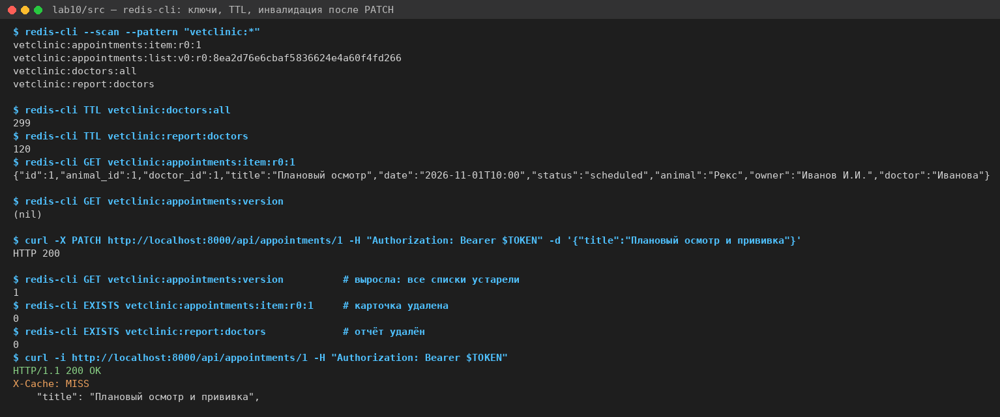
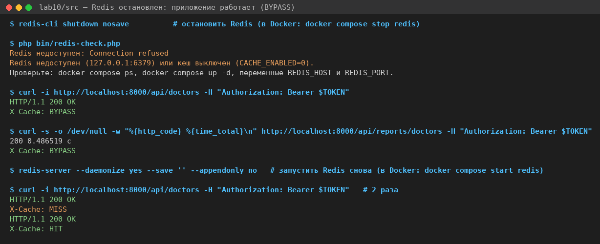
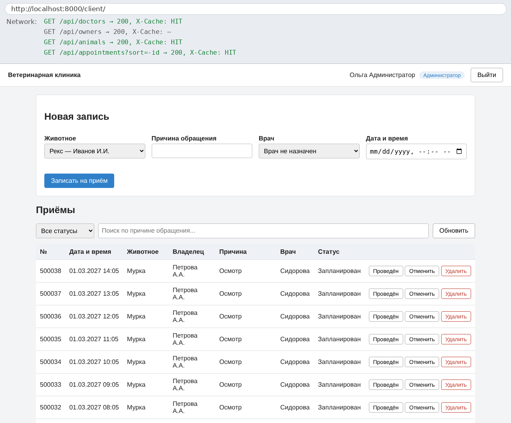
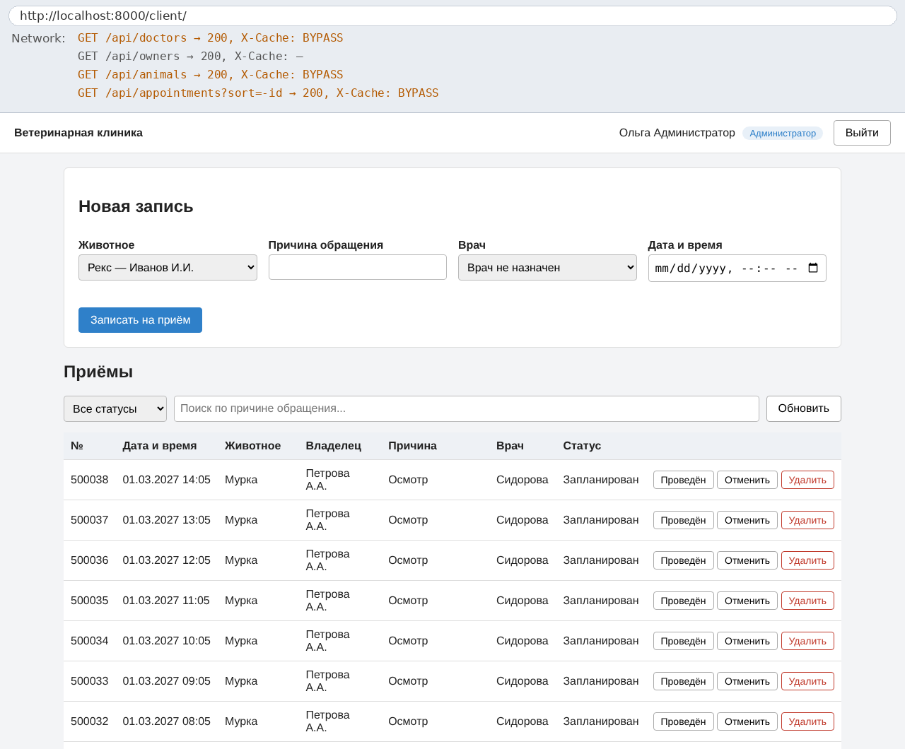
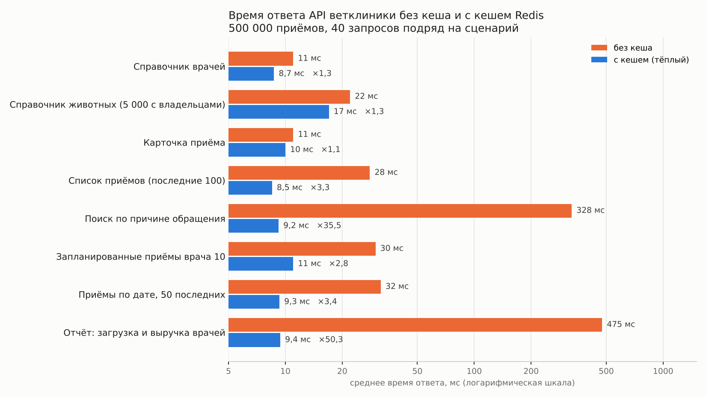
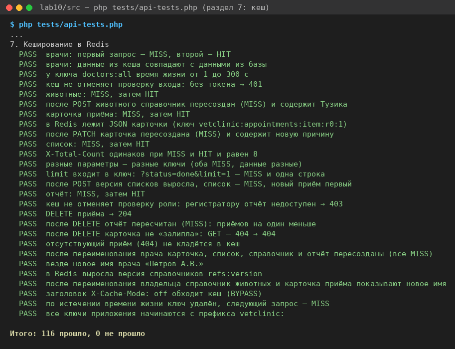

# Лабораторная работа №10
Выполнили - Парфенова Екатерина и Елена Ярмуш
## Кеширование данных

## Цель работы

Подключить Redis к системе «Ветеринарная клиника» из ЛР №9, кешировать часто запрашиваемые данные, обеспечить их получение из кеша при повторных запросах и измерить, как кеш влияет на производительность.

## Что сделано

1. **Пример «Задачи команды».** По заготовке выполнены все 11 заданий TODO, решение сохранено в истории Git отдельным коммитом:
   - подключение Redis;
   - методы `get`, `set`, `remember`;
   - кеш проектов, отчёта, карточек и списков;
   - инвалидация;
   - 2 своих сценария измерений и 10 своих проверок.

   Автотесты: 89 из 89 PASS. Измерения на 500 000 задач: поиск ×38, отчёт ×17, список проектов ×1,0.
2. **Перенос на ветклинику.** Кеш подключён к нашей системе из ЛР №9:
   - кешируются 5 видов данных;
   - ключи и правила инвалидации собраны в одном классе;
   - для измерений сгенерировано 500 000 приёмов.
3. **Проверка.** 116 автотестов, из них 27 про кеш. Измерения 8 сценариев в двух прогонах. Проверка работы без Redis.

## Запуск

Нужны Docker и PHP 8.2+ с расширениями `pdo_pgsql` и `redis` (phpredis). Установка phpredis:
- macOS: `pecl install redis`;
- Ubuntu: `sudo apt install php-redis`;
- Windows: библиотека `php_redis.dll` с pecl.php.net и строка `extension=redis` в php.ini.

```sh
cd lab10/src
docker compose up -d                                  # PostgreSQL 16 (база vetdb) и Redis 7
php bin/reset-db.php                                  # таблицы, тестовые данные, очистка кеша
php bin/redis-check.php                               # «Redis отвечает: PONG, версия 7.x»
PHP_CLI_SERVER_WORKERS=4 php -S localhost:8000 -t public
```

Клиент: http://localhost:8000/client/ (`admin@vet.example`, `registrar@vet.example`, `doctor@vet.example`, пароль `123456`).

- Автотесты: `php tests/api-tests.php`.
- Измерения: `php bin/load-bigdata.php`, затем `php bin/benchmark.php`. Скрипт работает около 5 минут.
- После измерений вернуть небольшую базу: `php bin/reset-db.php`.

Если порты 5432 или 6379 заняты (база ЛР №9, установленный Redis), запустите на других: `DB_PORT=5433 REDIS_PORT=6380 docker compose up -d`. Те же переменные передавайте серверу и скриптам. В Windows PowerShell: `$env:REDIS_PORT=6380`.

## Механизм кеширования

### Алгоритм cache-aside

```php
public static function remember(string $key, int $ttl, callable $load): mixed
{
    if (self::redis() === null) {          // Redis выключен или недоступен
        self::mark('BYPASS');
        return $load();
    }
    $cached = self::get($key);             // 1. проверить кеш
    if ($cached !== null) {
        self::mark('HIT');                 // 2. попадание: база не нужна
        return $cached;
    }
    $value = $load();                      // 3. промах: взять из базы
    if ($value !== null) {
        self::set($key, $value, $ttl);     // 4. сохранить в Redis с TTL (SETEX)
    }
    self::mark('MISS');
    return $value;
}
```

Значения хранятся в Redis как JSON. Ко всем ключам добавляется префикс `vetclinic:`. Результат виден в заголовке ответа `X-Cache`: `HIT`, `MISS` или `BYPASS`. Заголовок `X-Cache-Mode: off` (только при `debug = true`) обходит кеш, через него скрипт измерений получает время «без кеша».

Кеширующая модель меняет только чтение и добавляет инвалидацию, остальное наследует:

```php
final class CachedAppointmentRepository extends AppointmentRepository
{
    public function find(int $id): ?array
    {
        return Cache::remember(ClinicCache::itemKey($id), ClinicCache::TTL_ITEM, fn(): ?array => parent::find($id));
    }

    public function update(int $id, array $data): ?array
    {
        $item = parent::update($id, $data);
        ClinicCache::appointmentsChanged($id);   // версия списков +1, удалить карточку и отчёт
        return $item;
    }
    // search(), add(), delete() — так же
}
```

### Что кешируем

| Данные | Ключ | TTL | Почему кешируем |
|---|---|---|---|
| справочник врачей | `doctors:all` | 300 с | читается при каждом открытии страницы, меняется редко |
| справочник животных | `animals:all` | 300 с | читается при каждом открытии страницы, 5 000 строк с именами владельцев |
| карточка приёма | `appointments:item:r<R>:<id>` | 60 с | у каждого приёма своя запись |
| список приёмов | `appointments:list:v<V>:r<R>:<md5 всех параметров>` | 60 с | страница строк + COUNT по 500 000 строк; поиск по подстроке просматривает всю таблицу |
| отчёт «загрузка и выручка врачей» | `report:doctors` | 120 с | группировка по всем приёмам и услугам, около 0,5 с |

Новый адрес `GET /api/reports/doctors` (администратор и врачи) — тот же запрос, что представление `doctor_workload` в ЛР №8. Список приёмов теперь отдаётся постранично: `limit` (по умолчанию 100) и `offset`, общее число — в заголовке `X-Total-Count`. Без этого на 500 000 приёмов ответ весил бы сотни мегабайт.

Не кешируем:
- владельцев: их читает только одна форма;
- историю приёмов животного: она редкая и быстрая по индексу;
- проверку занятости врача при записи: устаревшая копия позволила бы записать двух животных на одно время.

Подробное обоснование: [docs/caching.md](docs/caching.md).

### Инвалидация

| Что изменилось | Что удаляется |
|---|---|
| приём (создан, изменён, удалён) | версия списков `appointments:version` +1, `report:doctors`, карточка приёма |
| врач | `doctors:all`, `report:doctors`, версия справочников `refs:version` +1; при удалении ещё и версия списков (у приёмов врач становится NULL) |
| животное | `animals:all`; при изменении и удалении — `refs:version` +1 |
| владелец | `animals:all`; при изменении — `refs:version` +1 |

Используются три способа:
- **удаление ключа** (DEL) — когда известно, какая запись устарела;
- **номер версии в имени ключа** (INCR) — для списков, которых может быть сотня с разными параметрами, а также для имён врачей, животных и владельцев внутри карточек и списков;
- **TTL** — страховка на случай, если инвалидация где-то не сработает.

Все правила собраны в `app/Models/ClinicCache.php`.

## Примеры работы с Redis

`curl`: первый запрос — MISS, повторный — HIT. Отчёт: 0,46 с из базы, затем 0,01 с из кеша.



`redis-cli`: ключи приложения, время жизни, содержимое карточки. После `PATCH` версия списков выросла, карточка и отчёт удалены, следующий запрос — MISS с новыми данными.



Redis остановлен: приложение отвечает 200 с `X-Cache: BYPASS`, просто медленнее. После запуска Redis кеш снова работает.



Клиент в браузере при остановленном Redis работает как обычно. Вверху снимков — запросы из вкладки Network со значением `X-Cache`:

| Redis работает | Redis остановлен |
|---|---|
|  |  |

В моём окружении Redis и PostgreSQL работали без Docker, поэтому на снимках остановка и запуск выполнены командами `redis-cli shutdown` и `redis-server`. С Docker то же самое делают `docker compose stop redis` и `docker compose start redis`.

## Сравнение производительности

Условия: 500 008 приёмов, 5 005 животных, 50 врачей. Облачная машина Linux: 2 ядра Intel Xeon 2,1 ГГц, 8 ГБ памяти. PHP 8.3 (встроенный сервер на 4 процессах), PostgreSQL 16.15, Redis 7.0.15, всё на одной машине. 40 запросов подряд на сценарий, затем 3 с нагрузки по 8 запросов одновременно. Ниже прогон 1; второй прогон и подробности — в [docs/benchmark.md](docs/benchmark.md).

| Сценарий | Без кеша, среднее (p95), мс | С кешем: первый запрос, мс | С кешем, среднее (p95), мс | Ускорение | Запросов/с без кеша | Запросов/с с кешем |
|----------|----------------------------|----------------------------|----------------------------|----------:|--------------------:|-------------------:|
| Справочник врачей | 11 (13) | 10 | 8,7 (12) | ×1,3 | 198 | 200 |
| Справочник животных (5 000 с владельцами) | 22 (27) | 23 | 17 (22) | ×1,3 | 94 | 121 |
| Карточка приёма | 11 (15) | 9,8 | 10 (13) | ×1,1 | 192 | 214 |
| Список приёмов (последние 100) | 28 (34) | 32 | 8,5 (11) | ×3,3 | 51 | 206 |
| Поиск по причине обращения | 328 (396) | 318 | 9,2 (11) | ×35,5 | 3 | 222 |
| Запланированные приёмы врача 10 | 30 (36) | 31 | 11 (13) | ×2,8 | 79 | 206 |
| Приёмы по дате, 50 последних | 32 (43) | 34 | 9,3 (12) | ×3,4 | 49 | 217 |
| Отчёт: загрузка и выручка врачей | 475 (528) | 492 | 9,4 (12) | ×50,3 | 4 | 201 |



Коротко:
- **Отчёт и поиск ускорились в 35–50 раз**, пропускная способность выросла с 3–4 до 200 запросов в секунду. Без кеша база для них просматривает все 500 тысяч приёмов.
- **Списки приёмов ускорились в 3 раза.** Дорогим в них был подсчёт COUNT для `X-Total-Count`.
- **Карточка приёма и справочник врачей почти не ускорились.** База и так отдаёт их за доли миллисекунды, а около 9 мс любого запроса — это запуск PHP и проверка токена, их кеш данных не убирает.
- **Справочник животных ускорился всего в 1,3 раза.** Ответ около 1 МБ, и с кешем остаются расходы на разбор JSON и передачу.
- **Первый запрос после очистки кеша** по времени такой же, как без кеша: это промах.

При обычной работе клиента доля попаданий по ответам API — 94%.

Разбор по каждому вопросу задания: [docs/benchmark.md](docs/benchmark.md).

## Автотесты

`php tests/api-tests.php` — 116 проверок, все PASS. Разделы 1–6 — это проверки ЛР №9: они проходят и с включённым кешем, значит устаревшие данные нигде не остаются. Раздел 7 — 27 проверок кеша:
- MISS и HIT для каждого вида данных;
- TTL;
- содержимое ключей в Redis;
- инвалидация после POST, PATCH и DELETE;
- переименование врача и владельца;
- обход кеша (BYPASS);
- истечение TTL;
- префикс ключей;
- кеш не отменяет проверки 401 и 403.



## Повышенная сложность

Выполнен пункт «доля попаданий». Скрипт имитировал 300 открытий страницы клиентом с записями на приём между ними. Доля попаданий по заголовку `X-Cache` — 94% (899 HIT, 61 MISS). По `INFO stats` получилось 76%: Redis считает промахом и каждое чтение ещё не созданного ключа версии `refs:version`. Подробнее в [docs/benchmark.md](docs/benchmark.md#доля-попаданий-при-обычной-работе).

## Что ещё нужно для эксплуатации

- мониторинг Redis: память, доля попаданий, число подключений;
- ограничение памяти Redis (`maxmemory` с политикой `allkeys-lru`): сейчас при большом числе разных запросов списков кеш может занять много памяти;
- разброс TTL и защита от «лавины», когда популярная запись (отчёт) истекает и десятки запросов одновременно идут в базу;
- ограничение попыток входа, HTTPS, пароли базы и Redis вне репозитория (остались с ЛР №9);
- настоящий веб-сервер вместо `php -S`: сейчас около 9 мс любого ответа уходит на запуск PHP и проверку токена.

## Вывод

Redis подключён к ветклинике через phpredis с коротким таймаутом и префиксом ключей, а при его недоступности приложение продолжает работать без кеша. Пять видов данных берутся по схеме cache-aside. У каждого продуманы ключ и время жизни, а при изменении данных устаревшие копии удаляются: по ключу, через номер версии или по истечении TTL.

Измерения на 500 тысячах приёмов показали, что кеш нужен там, где база делает много работы: отчёт ускорился в 50 раз, поиск в 35, списки в 3 раза. Для карточки по номеру и маленьких справочников выигрыша почти нет, а для больших ответов он ограничен передачей данных. Поэтому решение кешировать принимается по измерениям, а не «на всякий случай».

## Структура

```
lab10/
├── README.md
├── src/
│   ├── docker-compose.yml          PostgreSQL 16 (vetdb) и Redis 7
│   ├── sql/bigdata.sql             500 000 приёмов для измерений
│   ├── bin/                        reset-db, load-bigdata, redis-check, cache-demo, benchmark
│   ├── app/Core/Cache.php          кеш в Redis (из примера без изменений)
│   ├── app/Models/ClinicCache.php  ключи, TTL и инвалидация
│   ├── app/Models/Cached*.php      модели с кешем
│   └── tests/api-tests.php         автотесты, раздел 7 — кеш
├── images/                         скриншоты и диаграмма
└── docs/
    ├── caching.md                  что кешируем, ключи, TTL, инвалидация
    └── benchmark.md                условия, результаты двух прогонов, анализ
```
