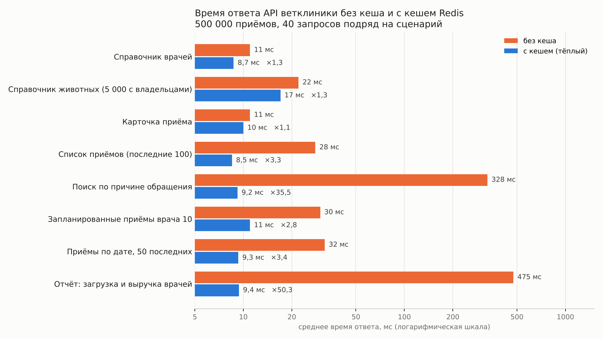
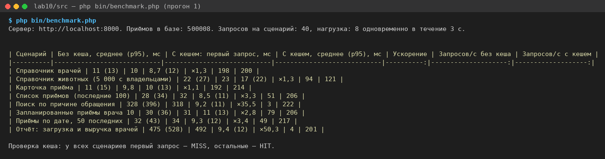

# Измерения производительности

## Условия

| Параметр | Значение |
|---|---|
| данные | 500 008 приёмов, 5 005 животных, 3 005 владельцев, 50 врачей, около 450 000 строк услуг (`php bin/load-bigdata.php`) |
| компьютер | облачная виртуальная машина Linux: 2 ядра Intel Xeon 2,1 ГГц, 8 ГБ памяти; база, Redis, сервер и скрипт измерений работают на одной машине |
| программы | PHP 8.3.6 со встроенным сервером на 4 процессах (`PHP_CLI_SERVER_WORKERS=4`), PostgreSQL 16.15, Redis 7.0.15 |
| скрипт | `php bin/benchmark.php` с параметрами по умолчанию: 40 запросов подряд на сценарий, затем нагрузка 3 с по 8 запросов одновременно |
| без кеша | запросы с заголовком `X-Cache-Mode: off`: кеш обходится, каждый запрос идёт в базу |
| с кешем | перед сценарием кеш очищается; первый запрос — холодный (MISS), остальные 39 — тёплые (HIT) |

Время одного запроса включает всё, что делает сервер: запуск PHP, проверку токена (два запроса к таблицам `auth_tokens` и `users`), работу контроллера и ответ JSON.

## Прогон 1

| Сценарий | Без кеша, среднее (p95), мс | С кешем: первый запрос, мс | С кешем, среднее (p95), мс | Ускорение | Запросов/с без кеша | Запросов/с с кешем |
|----------|----------------------------|----------------------------|----------------------------|----------:|--------------------:|-------------------:|
| Справочник врачей | 11 (13) | 10 | 8,7 (12) | ×1,3 | 198 | 200 |
| Справочник животных (5 000 с владельцами) | 22 (27) | 23 | 17 (22) | ×1,3 | 94 | 121 |
| Карточка приёма | 11 (15) | 9,8 | 10 (13) | ×1,1 | 192 | 214 |
| Список приёмов (последние 100) | 28 (34) | 32 | 8,5 (11) | ×3,3 | 51 | 206 |
| Поиск по причине обращения | 328 (396) | 318 | 9,2 (11) | ×35,5 | 3 | 222 |
| Запланированные приёмы врача 10 | 30 (36) | 31 | 11 (13) | ×2,8 | 79 | 206 |
| Приёмы по дате, 50 последних | 32 (43) | 34 | 9,3 (12) | ×3,4 | 49 | 217 |
| Отчёт: загрузка и выручка врачей | 475 (528) | 492 | 9,4 (12) | ×50,3 | 4 | 201 |

## Прогон 2

| Сценарий | Без кеша, среднее (p95), мс | С кешем: первый запрос, мс | С кешем, среднее (p95), мс | Ускорение | Запросов/с без кеша | Запросов/с с кешем |
|----------|----------------------------|----------------------------|----------------------------|----------:|--------------------:|-------------------:|
| Справочник врачей | 12 (14) | 12 | 9,2 (11) | ×1,3 | 197 | 192 |
| Справочник животных (5 000 с владельцами) | 27 (36) | 28 | 17 (21) | ×1,6 | 79 | 104 |
| Карточка приёма | 11 (14) | 10 | 11 (13) | ×1,0 | 185 | 196 |
| Список приёмов (последние 100) | 31 (37) | 25 | 9,1 (11) | ×3,4 | 43 | 193 |
| Поиск по причине обращения | 358 (399) | 348 | 10 (12) | ×34,5 | 3 | 181 |
| Запланированные приёмы врача 10 | 34 (50) | 28 | 11 (13) | ×3,1 | 71 | 189 |
| Приёмы по дате, 50 последних | 31 (46) | 27 | 9,7 (12) | ×3,2 | 45 | 192 |
| Отчёт: загрузка и выручка врачей | 507 (635) | 548 | 11 (16) | ×46,1 | 4 | 200 |

Результаты двух прогонов близки: у отчёта ×50 и ×46, у поиска ×35 и ×35, у карточки ×1,1 и ×1,0. Разброс среднего между прогонами — до 10%, у p95 больше. Это обычный «шум» одной машины, на которой одновременно работают база, сервер и скрипт измерений. Вывод от него не меняется.

## Доля попаданий при обычной работе

Скрипт имитировал работу клиента:
- 300 открытий страницы, каждое — справочник животных, справочник врачей и список приёмов;
- каждое пятое открытие — ещё и отчёт;
- каждое десятое — запись на приём, то есть изменение данных.

Перед запуском счётчики Redis сброшены командой `CONFIG RESETSTAT`.

| Показатель | Значение |
|---|---|
| ответы API с `X-Cache: HIT` | 899 |
| ответы API с `X-Cache: MISS` | 61 |
| доля попаданий по ответам API | 899 / 960 = **94%** |
| `keyspace_hits` / `keyspace_misses` из `INFO stats` | 1 189 / 371, то есть 76% |

Доля по `INFO stats` ниже, потому что Redis считает каждое чтение ключа. Номер версии `refs:version` читается при каждом запросе списка, а до первого изменения врача или животного этого ключа нет. Каждое такое чтение Redis записывает как промах, хотя сам список потом берётся из кеша. Поэтому долю попаданий честнее считать по ответам приложения.

## Анализ

**Самый большой выигрыш — у отчёта (×46–50) и поиска (×35).** Без кеша отчёт по врачам читает все 500 тысяч приёмов и 450 тысяч строк услуг, считает группировку и тратит около 0,5 с. Поиск `title ILIKE '%осмотр №4999%'` тоже просматривает всю таблицу: обычный индекс для поиска подстроки не подходит (ЛР №8). С кешем оба отвечают за 9–11 мс, а пропускная способность выросла с 3–4 до 180–220 запросов в секунду. Прогноз из теории подтвердился: кеш выигрывает там, где база делает много работы.

**Списки приёмов ускорились в 3 раза.** Страница из 100 или 50 строк по индексу берётся быстро. Но к ней добавляется подсчёт всех подходящих строк для `X-Total-Count`, и именно COUNT по 500 тысячам строк делает запрос тяжёлым (около 30 мс). Пропускная способность выросла в 2,5–4,5 раза.

**Самый маленький выигрыш — у карточки приёма (×1,0–1,1) и справочника врачей (×1,3).** Карточка читается по первичному ключу за доли миллисекунды, справочник врачей — это 50 строк. Остальное время запроса не зависит от кеша: запуск PHP и проверка токена. Это «пол» в 8–9 мс, ниже которого с кешем данных не опуститься. Здесь интуиция «кеш ускорит всё» не подтвердилась, как и предупреждает теория.

**Справочник животных ускорился всего в 1,3–1,6 раза**, хотя запрос не самый лёгкий: 5 тысяч строк с подзапросом имени владельца на каждую. Дело в том, что с кешем остаются расходы на сам объём данных. Строку JSON в 616 КБ (`STRLEN vetclinic:animals:all`) нужно передать из Redis и разобрать в массив (`json_decode`). Затем её снова собирают в JSON для ответа: с отступами он весит уже 966 КБ, и его надо отправить клиенту. Для больших ответов кеш экономит только работу базы, а не передачу данных. Ускорить такой справочник можно иначе: отдавать животных постранично или поиском, а не целиком.

**Первый запрос (холодный кеш)** по времени такой же, как без кеша: данных в Redis нет, сервер идёт в базу и затем записывает результат в Redis. Запись добавляет доли миллисекунды и в измерениях незаметна. Весь выигрыш появляется на повторных запросах, пока запись живёт (60–300 с) и её не удалила инвалидация.

**Если данные меняются каждую секунду.** Каждая запись на приём увеличивает версию списков и удаляет отчёт. При изменениях чаще, чем записи успевают прочитать, почти каждый запрос становится промахом: приложение идёт в базу и ещё тратит время на запись в Redis, которая никому не пригодится. Доля попаданий падает, и кеш начинает только мешать. Варианты решения:
- не инвалидировать отчёт сразу, а жить с TTL в 30–60 секунд (допустимо «чуть устаревшее»);
- кешировать только справочники, которые меняются редко;
- для отчёта считать агрегаты заранее (таблица итогов, материализованное представление) вместо кеша.

**Когда кеш не нужен:**
- данные читаются мгновенно: карточка по первичному ключу, маленький справочник;
- данные почти никто не читает повторно;
- данные меняются чаще, чем их читают;
- нельзя показывать даже секундное отставание: занятость врача при записи на приём проверяется по базе, а не по кешу (`doctorBusy`), иначе можно записать двух животных на одно время;
- ответ очень большой: как справочник животных, где выигрыш съедает передача данных.
