# Лабораторная работа №11
Выполнили - Парфенова Екатерина и Елена Ярмуш
## Асинхронная обработка данных

## Цель работы

Изучить асинхронную обработку данных: вынести долгие операции системы «Ветеринарная клиника» в фоновые задачи с очередью сообщений в Redis, настроить Worker-процесс, который их выполняет, и сравнить время ответа с очередью и без неё.

## Механизм очередей

Очередь построена на списках Redis, тех же, что используются для кеша в ЛР №10 (префикс `vetclinic:`). Очередей две:
- `default` — письма владельцам;
- `reports` — отчёты.

Отдельная очередь нужна, чтобы быстрое письмо не стояло за отчётом по 500 тысячам приёмов.

| Ключ | Тип | Что хранит |
|---|---|---|
| `queue:default`, `queue:reports` | список | ожидающие задачи |
| `queue:<имя>:processing` | список | задачи «в работе»: воркер взял, но ещё не подтвердил |
| `queue:<имя>:delayed` | упорядоченное множество | задачи, ждущие повтора (оценка — время повтора) |
| `queue:<имя>:dead` | список | «мёртвая» очередь: задачи, не выполненные за 3 попытки |
| `queue:<имя>:reserved` | хеш | номер задачи → когда её взял воркер |

Задача — JSON-строка. В неё кладётся только то, что нужно для работы:

```json
{"id": "ef1b4a7c744179da", "type": "notification",
 "payload": {"appointment_id": 1, "event": "cancelled", "email": "ivanov@example.org", "owner": "Иванов И.И.",
             "animal": "Рекс", "title": "Плановый осмотр", "date": "2026-11-01T10:00", "doctor": "Иванова"},
 "attempts": 0, "created_at": "2026-11-20T21:10:41+00:00"}
```

Для отчёта в payload только номер заявки `{"report_id": 1}`: параметры и результат хранятся в таблице `report_requests`.

Путь задачи:
1. **Постановка.** `Jobs::dispatch()` вызывает `Queue::push()`, тот кладёт задачу в очередь командой `LPUSH`.
2. **Взятие.** Воркер вызывает `Queue::reserve()`: команда `BLMOVE` одним действием перекладывает задачу в «в работе».
3. **Выполнение.** `Jobs::run()` запускает обработчик по типу задачи.
4. **Подтверждение.** `Queue::ack()` удаляет задачу из «в работе» командой `LREM`.

Задачу не достают из очереди командой `RPOP`, а перекладывают: если воркер упадёт, задача останется на виду в «в работе» и не пропадёт.

Постановка задачи из приложения: ответ на `PATCH` пришёл за 13 мс с заголовком `X-Job-Id`, задача лежит в Redis.

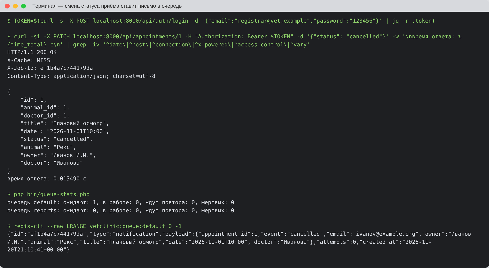

Проверка очереди без приложения: `php bin/queue-check.php` ([снимок](images/01-queue-check.png)).

Надёжность:
- **Повторы и «мёртвая» очередь.** Если обработчик бросил исключение, задача повторяется через 2 с и 4 с, а после третьей неудачи уходит в «мёртвую» очередь вместе с текстом ошибки.
- **Как минимум один раз.** Задача может выполниться дважды (воркер записал результат, но упал до ack), поэтому обработчики идемпотентны. Письмо записывается через `INSERT ... ON CONFLICT (job_id, recipient) DO NOTHING`, отчёт перезаписывает тот же файл и ту же заявку.

Подробно: [docs/queue.md](docs/queue.md).

## Worker-процесс

`bin/worker.php` — отдельная программа, не связанная с веб-сервером. На каждую очередь запускается свой воркер:

```sh
php bin/worker.php                    # письма (очередь default)
php bin/worker.php --queue=reports    # отчёты
php bin/worker.php --until-empty      # выполнить всё, что есть, и выйти
```

Цикл:

```php
while ($running) {
    Queue::promote($queue);                 // вернуть в очередь задачи, у которых прошла пауза перед повтором
    // раз в 10 с: Queue::recover($queue)   — вернуть задачи, зависшие у упавшего воркера
    $reserved = Queue::reserve($queue, 2);  // BLMOVE: ждать задачу не дольше 2 с, чтобы проверять флаг остановки
    if ($reserved === null) { continue; }
    [$job, $raw] = $reserved;
    try {
        Jobs::run($job);                    // NotificationJob или ReportJob — по полю type
        Queue::ack($raw, $queue);
    } catch (Throwable $e) {
        Queue::fail($job, $raw, $e->getMessage(), $queue);   // повтор через 2, 4 с или «мёртвая» очередь
    }
}
```

Воркер выполняет три письма по очереди, каждое «отправляется» 2 секунды:

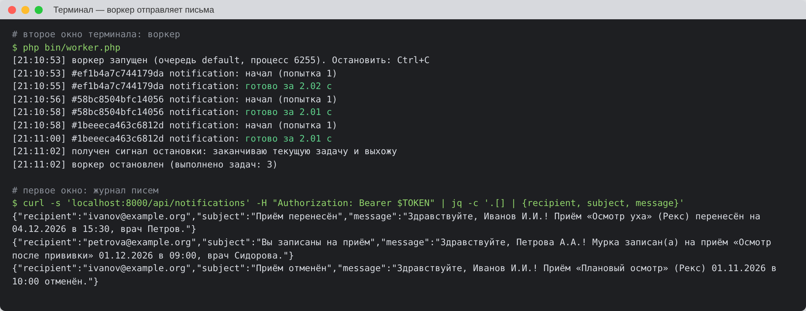

**Повторы.** Задача, которая падает всегда, выполняется три раза с паузами 2 и 4 с и уходит в «мёртвую» очередь. «Нестабильная» задача получается с третьей попытки:

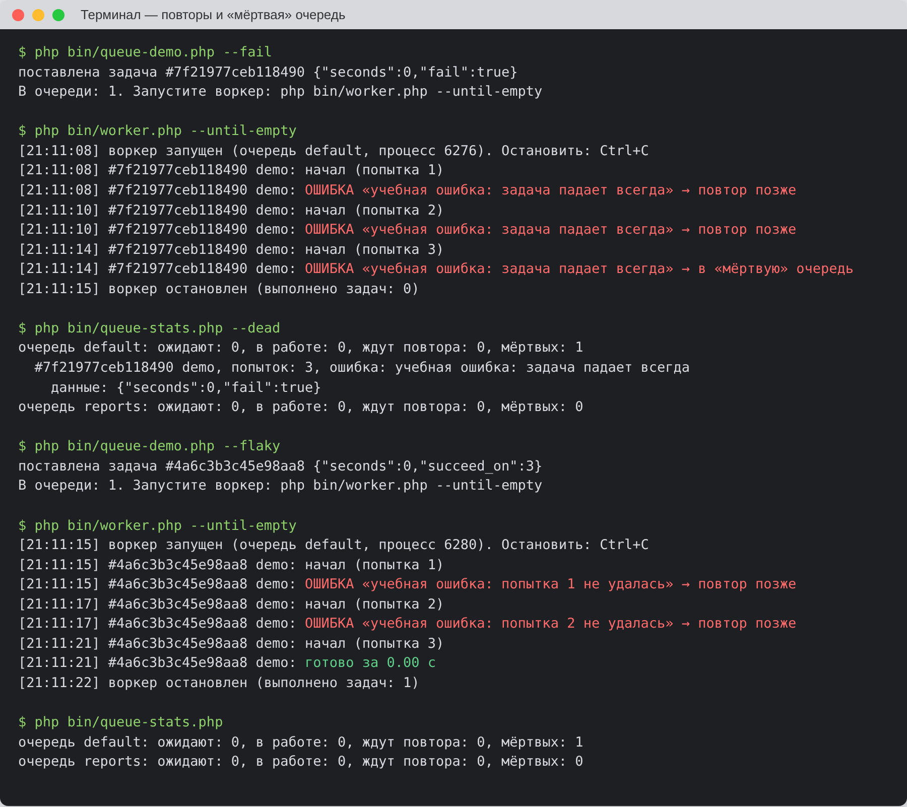

**Восстановление после сбоя.** Воркер убит командой `kill -9` посреди 20-секундной задачи. Задача осталась «в работе», новый воркер вернул её в очередь и выполнил.

Возвращаются только задачи, взятые больше `QUEUE_STUCK_AFTER` секунд назад (по умолчанию 120 с, больше самой долгой задачи). Иначе второй запущенный воркер забрал бы задачу у живого первого. На снимке срок уменьшен до 5 с, чтобы не ждать.

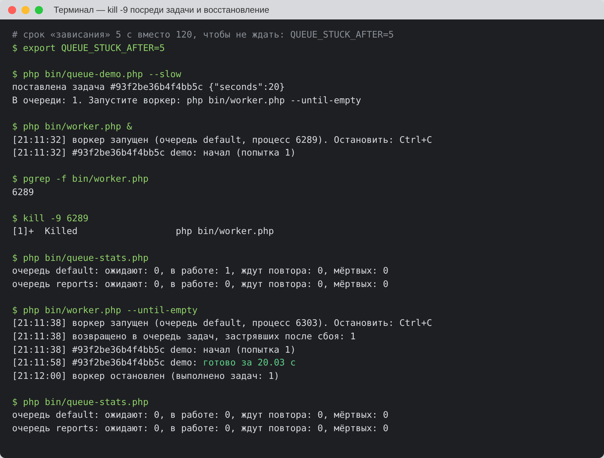

**Корректная остановка.** Сигналы SIGINT (Ctrl+C) и SIGTERM перехватываются через `pcntl`: флаг `$running` снимается, текущая задача доделывается, затем воркер выходит. В Windows расширения `pcntl` нет: там воркер останавливается сразу, а незавершённая задача вернётся в очередь при следующем запуске.

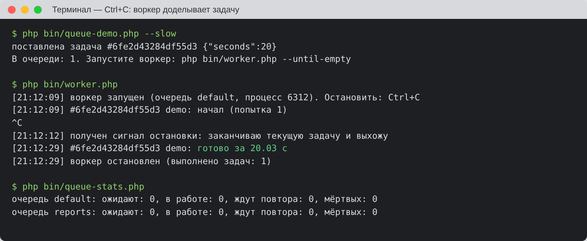

**Воркер остановлен.** Приём отмечен проведённым, ответ пришёл за 18 мс, письмо ждёт в очереди. Воркер запустили — письмо ушло.

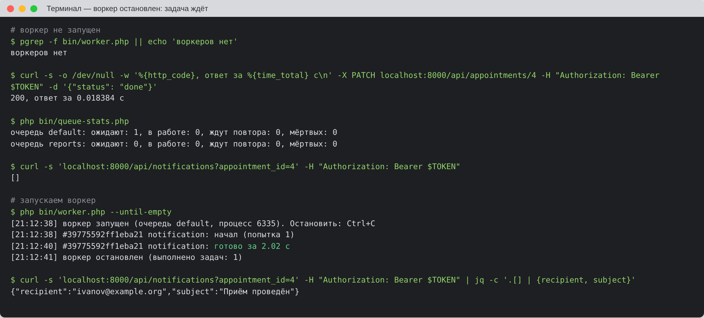

## Асинхронные операции

| Операция | Почему в фоне | Как отвечает сервер | Как узнать результат |
|---|---|---|---|
| **Письмо владельцу** при записи на приём, переносе, отмене и проведении приёма | почтовый сервер медленный (имитация — 2 с) и может не отвечать, а регистратору ответ нужен сразу | как раньше (200 или 201), номер задачи в заголовке `X-Job-Id` | журнал писем `GET /api/notifications?appointment_id=1` (администратор, регистратор) |
| **Отчёт по приёмам в CSV** за период и по статусу: дата, животное, владелец, телефон, врач, услуги, сумма | на 500 тысячах приёмов строится 3,5 с, файл около 100 МБ | `202 Accepted`, заголовок `Location: /api/reports/{id}`, заявка со статусом `queued` | `GET /api/reports/{id}`: `queued` → `processing` → `done` (строк, выручка) или `failed` (текст ошибки); файл — `GET /api/reports/{id}/download` (пока не готов — 409) |

Письмо не ставится, если писать некому (у владельца нет почты) или ничего не изменилось (поправили только причину обращения). Отчёт заказывают администратор и врачи. Заявку видят её автор и администратор.

Что не вынесено в фон:
- **Вход и проверка пароля:** без ответа нельзя продолжить работу.
- **Запись на приём и проверка занятости врача:** регистратор должен сразу узнать, записан ли пациент, а при одновременной записи — получить 409.
- **Отчёт «загрузка врачей»:** он короткий и уже кешируется (ЛР №10).

Отчёт по 500 008 приёмам: ответ за 18 мс, через секунду заявка `processing`, через 3,7 с — `done`, файл 101 МБ:

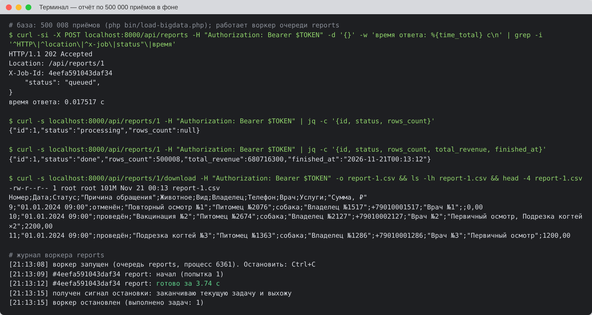

## Результаты измерений

`php bin/bench-async.php --n=5`: по 5 запросов в каждом режиме на базе из 500 008 приёмов. Режим «без очереди» — заголовок `X-Queue-Mode: sync`: сервер выполняет задачу прямо в запросе. Работали сервер `php -S` на 4 процессах и по воркеру на каждую очередь. Всё на одной машине: 2 ядра Intel Xeon 2,1 ГГц, 8 ГБ, PHP 8.3, PostgreSQL 16, Redis 7.

| Операция | Без очереди: ответ, мс | С очередью: ответ, мс | С очередью: результат готов через, мс | Ответ быстрее |
|----------|------------------------:|-----------------------:|--------------------------------------:|--------------:|
| Перенос приёма + письмо владельцу | 2 026 | 19 | 2 054 | ×109 |
| Отчёт по 500 008 приёмам в CSV | 3 463 | 12 | 3 658 | ×279 |

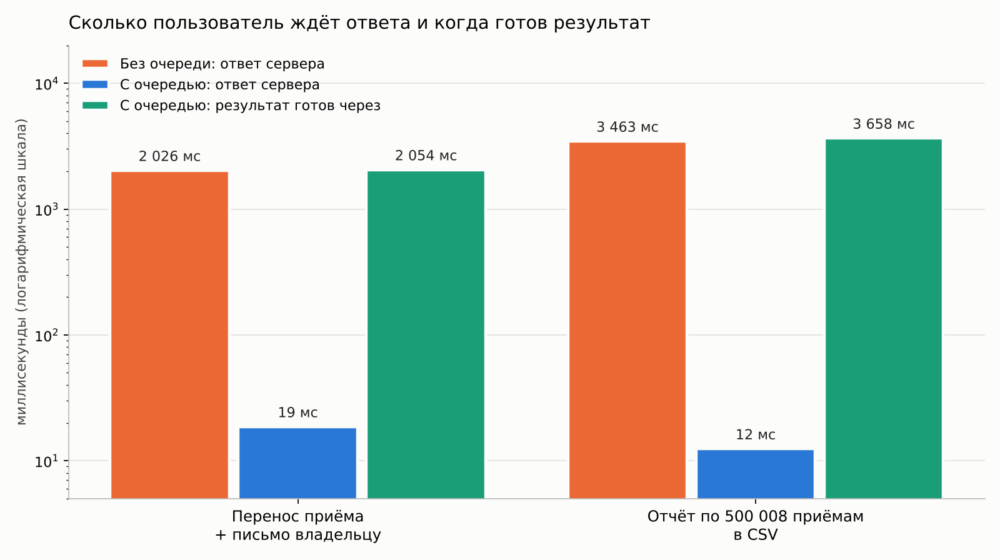

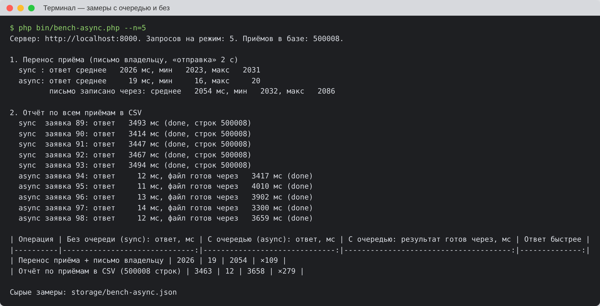

Анализ:
- **Работа не ускорилась.** Письмо по-прежнему «отправляется» 2 с, отчёт строится 3,5 с. С очередью результат готов даже немного позже: +30 мс у письма и +200 мс у отчёта. Задача ждёт, пока воркер её заберёт, а воркер и сервер делят два ядра.
- **Ускорился ответ.** Регистратор получает ответ за 12–19 мс вместо 2–3,5 с и сразу работает дальше. Процесс веб-сервера не занят ожиданием почты и тут же обслуживает следующий запрос.
- **Цена.** Результата сразу нет: отчёт клиент спрашивает повторно, а письмо уходит позже ответа. Нужен постоянно работающий воркер: если его нет, задачи копятся. Нужно думать о сбоях: повторы, «мёртвая» очередь, идемпотентность, восстановление. Появились ещё одна таблица, ещё один процесс и ещё одна точка отказа (Redis).
- **На маленькой базе (8 приёмов)** отчёт строится за 16 мс, и очередь ему не нужна. В фон его стоит выносить, только когда данных много.

## Автотесты

`php tests/api-tests.php` — 174 проверки, все PASS. Разделы 1–7 — проверки ЛР №9 и №10 (116). Новые разделы:
- **8. Письмо владельцу:** ответ быстрее 1 с, `X-Job-Id`, состав задачи в Redis, письма о записи, переносе, отмене и проведении, нет письма без почты или без изменений, режим sync, права.
- **9. Воркер:**
  - повторы с растущей паузой и «мёртвая» очередь;
  - восстановление после «падения» и после настоящего `kill -9`;
  - срок «зависания»;
  - Ctrl+C посреди задачи;
  - идемпотентность;
  - письмо об уже удалённом приёме.
- **10. Отчёт:** 202 и `Location`, очередь `reports`, статусы, число строк и выручка совпадают с базой, CSV с меткой UTF-8, фильтр по периоду и статусу, 422, 403, 404, 401, заявка `failed` после трёх неудачных попыток.
- **11. Свои проверки:** письмо не ждёт отчёты, `GET /api/queue/stats`, два воркера выполняют каждую задачу ровно один раз и вдвое быстрее одного.

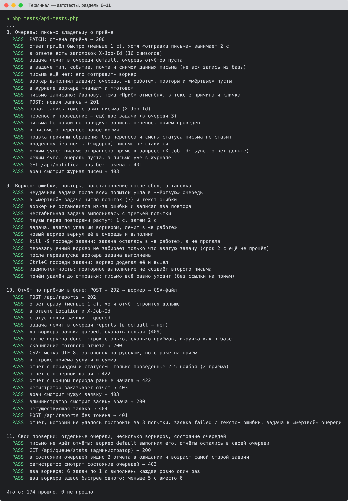

Пример из заготовки «Задачи команды» решён полностью (все 14 заданий), решение сохранено в истории Git: 117 проверок из 117, уведомление с очередью 17 мс против 2 025 мс без неё.

## Повышенная сложность

- **Несколько очередей.** Отчёты в `reports`, письма в `default`, по воркеру на каждую. Решённая проблема видна по примеру: там очередь одна, и отчёт, заказанный после четырёх уведомлений, был готов через 10 с вместо 2.
- **Несколько воркеров.** 10 задач по 1 с: один воркер — 11,1 с, два — 6,1 с. Каждый выполнил 5 задач, повторов нет: `BLMOVE` отдаёт задачу только одному воркеру.

  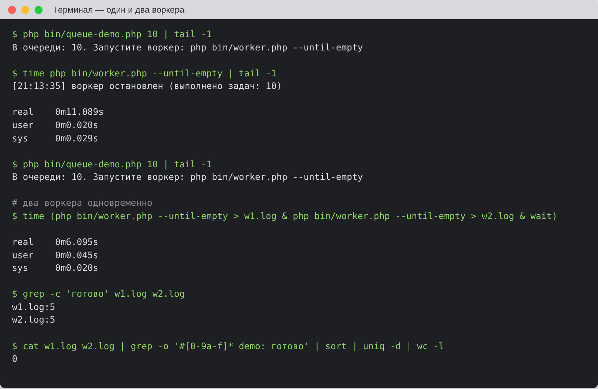
- **Срок выполнения.** `recover` возвращает только задачи, взятые больше `QUEUE_STUCK_AFTER` секунд назад, поэтому второй воркер не забирает задачу у первого.
- **Метрики.** `GET /api/queue/stats` (администратор): размеры списков каждой очереди, возраст самой старой ожидающей задачи, последние «мёртвые» задачи с ошибками ([снимок](images/12-queue-stats.png)).

## Что ещё нужно для эксплуатации

- управление воркерами через Supervisor, systemd или отдельный контейнер с автоматическим перезапуском;
- схема outbox: задача пишется в базу той же транзакцией, что и приём, иначе при недоступном Redis письмо теряется;
- журнал AOF и том для Redis, иначе очередь пропадёт вместе с контейнером;
- оповещение, когда растёт длина очереди или появляются «мёртвые» задачи (данные уже есть в `GET /api/queue/stats`), и инструмент повторного запуска «мёртвых» задач;
- настоящая отправка писем с ключом идемпотентности и удаление старых файлов отчётов.

## Вывод

Очередь на списках Redis позволила системе ветклиники не ждать долгих операций. Письмо владельцу и отчёт по приёмам ставятся в очередь, а пользователь получает ответ за 12–19 мс вместо 2–3,5 с. Работу выполняют воркеры. Ошибки повторяются с растущей паузой, затем попадают в «мёртвую» очередь. Задача упавшего воркера не теряется. При остановке текущая задача доделывается. Повторное выполнение не создаёт дублей.

Очередь не ускоряет саму работу: результат готов через то же время, что и без неё, или чуть позже. Она отделяет работу от ответа, и за это приходится платить: нужен воркер, нужно следить за очередью и продумывать сбои. Поэтому в фон вынесены только долгие и ненадёжные операции.

## Структура

```
lab11/
├── README.md
├── src/
│   ├── docker-compose.yml          PostgreSQL 16 и Redis 7
│   ├── app/Core/Queue.php          очередь в Redis
│   ├── app/Jobs/                   Jobs (реестр), NotificationJob, ReportJob, DemoJob
│   ├── bin/worker.php              воркер
│   ├── bin/                        queue-check, queue-demo, queue-stats, bench-async, reset-db, load-bigdata
│   ├── storage/reports/            готовые CSV-файлы
│   └── tests/api-tests.php         автотесты, разделы 8–11 — очередь
├── images/                         скриншоты и диаграмма
└── docs/
    └── queue.md                    устройство очереди, гарантии, повторы, идемпотентность, ограничения
```
