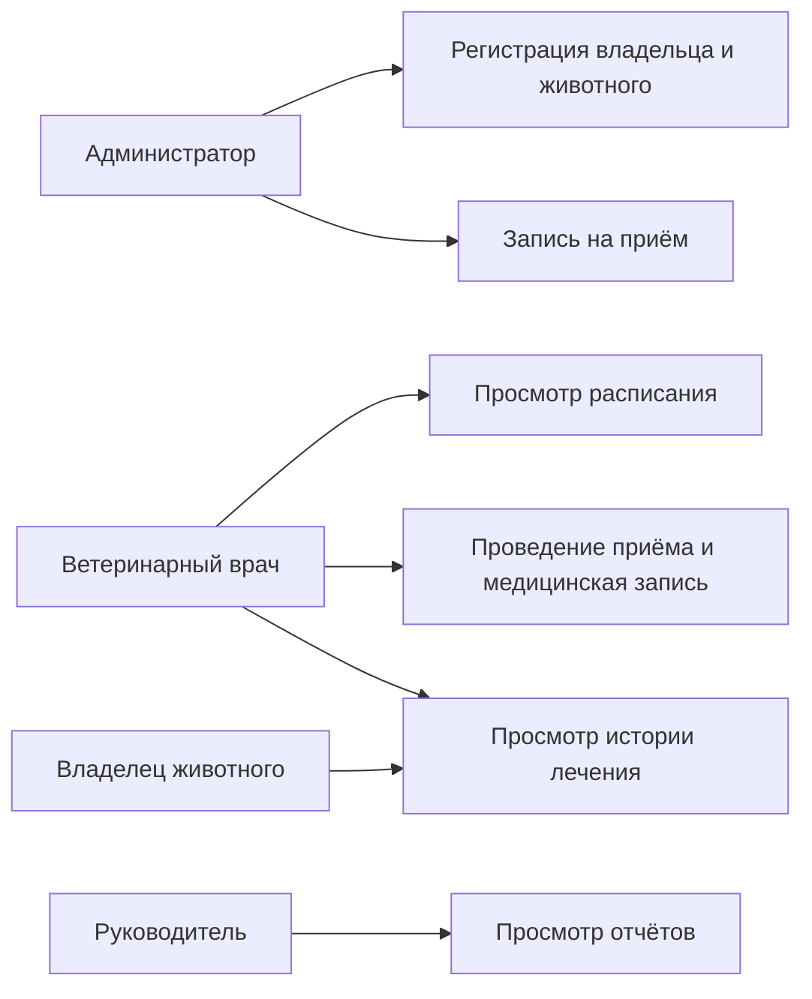
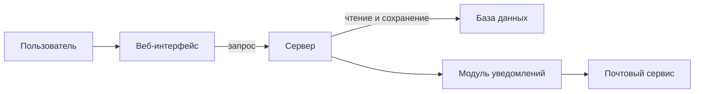

# Лабораторная работа №2
## Проектирование информационной системы

## Цель работы

Определить пользователей, описать сценарии работы и основные компоненты системы.

## 1. Описание системы

Система управления ветеринарной клиникой нужна для хранения информации о владельцах, животных, врачах, приёмах и медицинских записях. Она помогает отказаться от бумажных журналов и быстро находить историю лечения.

## 2. Пользователи и роли

| Роль | Что делает | Доступ |
|---|---|---|
| Владелец животного | Смотрит данные животного и историю лечения | Только свои животные |
| Администратор | Регистрирует владельцев и животных, записывает на приём | Данные клиентов и расписание |
| Ветеринарный врач | Проводит приём и создаёт медицинскую запись | Расписание и медицинские записи |
| Руководитель | Смотрит отчёты | Отчёты о работе клиники |

## 3. Сценарии использования

### 1. Регистрация владельца и животного

Кто выполняет: администратор.

1. Открывает список владельцев.
2. Проверяет, зарегистрирован ли владелец.
3. Вводит данные нового владельца или выбирает существующего.
4. Добавляет данные животного.
5. Сохраняет информацию.

Результат: владелец и животное добавлены в систему.

### 2. Запись на приём

Кто выполняет: администратор.

1. Выбирает животное.
2. Выбирает врача.
3. Указывает дату и время.
4. Система проверяет, свободен ли врач.
5. Сохраняет запись на приём.

Результат: животное записано к врачу. Если время занято, нужно выбрать другое.

### 3. Просмотр расписания

Кто выполняет: ветеринарный врач.

1. Входит в систему.
2. Открывает своё расписание.
3. Выбирает дату.
4. Система показывает приёмы на эту дату.
5. Врач выбирает нужный приём.

Результат: врач видит список своих приёмов.

### 4. Проведение приёма

Кто выполняет: ветеринарный врач.

1. Открывает запись на приём.
2. Смотрит данные животного и историю лечения.
3. Проводит осмотр.
4. Вводит диагноз и назначения.
5. Сохраняет медицинскую запись.

Результат: результаты приёма сохранены в истории животного.

### 5. Просмотр истории лечения

Кто выполняет: ветеринарный врач или владелец.

1. Входит в систему.
2. Выбирает животное.
3. Открывает его карточку.
4. Выбирает раздел «История лечения».
5. Система показывает прошлые приёмы и назначения.

Результат: пользователь видит историю лечения. Владелец может смотреть только своих животных.

## 4. Диаграмма вариантов использования

Это краткая схема. [Диаграмма с обозначениями UML](diagrams/use-cases.puml) показывает роли, варианты использования и границу системы.

## 5. Компоненты системы

| Компонент | Для чего нужен |
|---|---|
| Веб-интерфейс | Страницы, через которые работают пользователи |
| Сервер | Обрабатывает запросы и проверяет права |
| База данных | Хранит информацию о работе клиники |
| Модуль уведомлений | Подготавливает сообщение о записи |
| Почтовый сервис | Отправляет письмо владельцу |

## 6. Диаграмма компонентов

[Исходник диаграммы](diagrams/architecture.puml). Пользователь работает через страницы системы, сервер обращается к базе данных и при необходимости отправляет письмо.

## 7. Концепция системы

Система является веб-приложением. Основные возможности: учёт владельцев и животных, запись на приём, просмотр расписания, ведение медицинских записей и просмотр отчётов.

## Вывод

Определены пользователи, описаны пять сценариев и основные компоненты системы.
