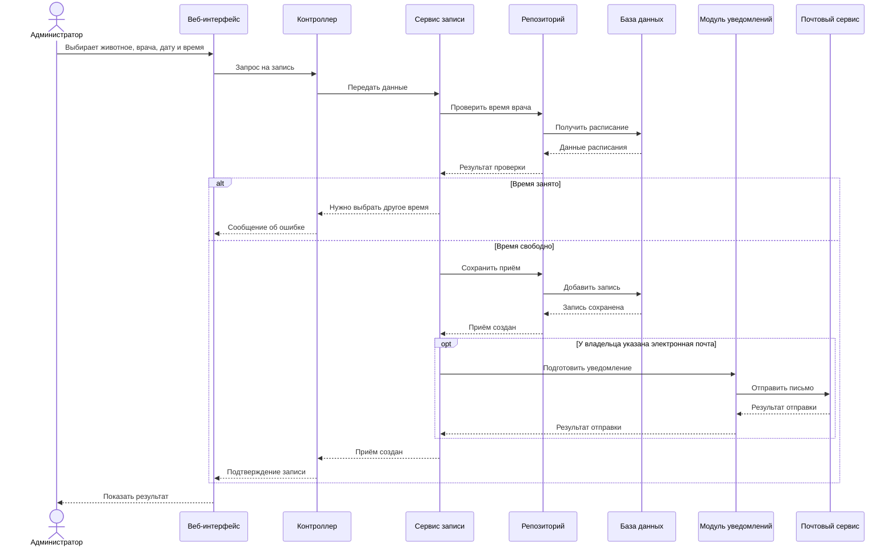
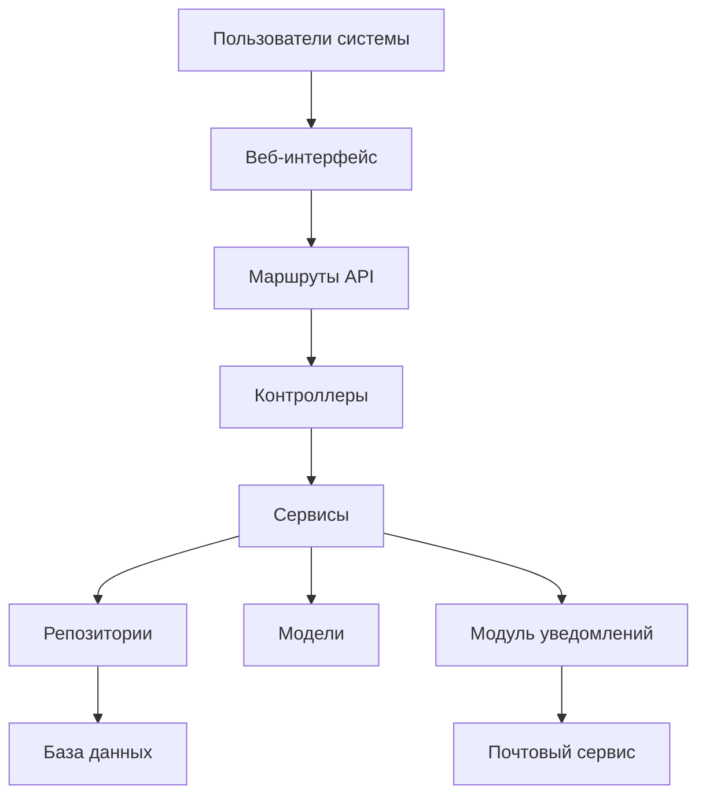

# Лабораторная работа №3
## Проектирование архитектуры информационной системы

## Цель работы

Определить структуру приложения, основные компоненты и порядок их взаимодействия.

## Шаг 1. Архитектура приложения

Выбрано веб-приложение с трёхуровневой архитектурой.

| Уровень | Назначение |
|---|---|
| Клиентская часть | Показывает страницы и принимает данные пользователя |
| Серверная часть | Обрабатывает запросы и проверяет права. Планируется использовать PHP |
| База данных | Хранит сведения о владельцах, животных, врачах и приёмах. Планируется использовать MySQL |

Такое разделение позволяет отдельно изменять страницы, обработку запросов и хранение данных.

## Шаг 2. Компоненты системы

| Компонент | За что отвечает |
|---|---|
| Веб-интерфейс | Формы, таблицы и отправка запросов |
| Маршруты API | Передача запроса нужному контроллеру |
| Контроллеры | Приём запроса, проверка данных и формирование ответа |
| Сервисы | Регистрация, запись на приём, медицинские записи и отчёты |
| Репозитории | Чтение и сохранение данных |
| Модели | Описание объектов предметной области |
| Модуль уведомлений | Подготовка и отправка писем владельцам |
| База данных | Хранение информации |
| Почтовый сервис | Отправка писем по электронной почте |

## Шаг 3. Взаимодействие компонентов

Пользователь заполняет форму. Веб-интерфейс отправляет запрос серверу. Контроллер проверяет данные и вызывает сервис. Сервис обращается к репозиторию, который работает с базой данных. Результат возвращается пользователю.

Сценарий записи на приём:



[Исходник диаграммы](diagrams/sequence-appointment.mmd).

## Шаг 4. Индивидуальная особенность

Модуль уведомлений отправляет владельцу письмо при создании, переносе или отмене приёма. Это помогает напомнить о дате и времени посещения.

Модуль получает сведения о приёме и обращается к почтовому сервису. Если почта не указана, письмо не отправляется. Ошибка отправки не отменяет сохранённый приём. Отдельная фоновая обработка в этой работе не рассматривается.

## Шаг 5. Структура проекта

```text
src/
  frontend/             — страницы системы
  backend/
    controllers/        — контроллеры
    services/           — обработка действий
    repositories/       — работа с данными
    models/             — модели
    routes/             — маршруты API
  database/             — файлы базы данных
  docs/                 — документация
```

[Описание каталогов](src/README.md). Программная часть пока не реализована.

## Шаг 6. Схема архитектуры



[Исходник схемы](diagrams/architecture.mmd). Модуль уведомлений выделен отдельно и связан с почтовым сервисом.

## Описание API

[Основные запросы](../docs/api.md): регистрация владельца и животного, запись на приём, просмотр расписания, медицинские записи и отчёты.

## Вывод

Спроектирована архитектура ветеринарной клиники. Определены компоненты, структура проекта и порядок обработки записи на приём.
