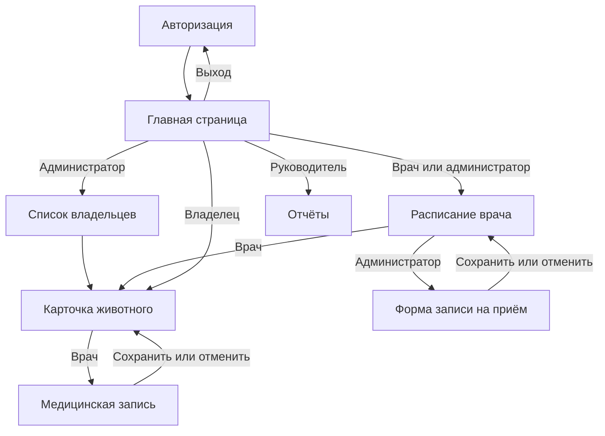

# Лабораторная работа №4
## Проектирование пользовательского интерфейса

## Цель работы

Определить экраны системы, переходы между ними и подготовить макеты страниц.

## 1. Структура экранов

| Экран | Назначение | Основные элементы и действия | Роль |
|---|---|---|---|
| Авторизация | Вход в систему | Логин, пароль, кнопка входа | Все |
| Главная страница | Переход в разделы | Меню, краткая информация, выход | Все |
| Список владельцев | Поиск и регистрация | Поиск, таблица, форма добавления владельца и животного | Администратор |
| Карточка животного | Просмотр данных | Данные животного, история лечения | Администратор, врач, владелец |
| Форма записи на приём | Создание или перенос записи | Животное, врач, дата, время, сохранить, отмена | Администратор |
| Расписание врача | Просмотр приёмов | Дата, таблица приёмов, переход к карточке | Врач, администратор |
| Медицинская запись | Результаты приёма | Жалобы, диагноз, назначения, услуги, сохранение | Врач |
| Отчёты | Просмотр работы клиники | Период, показатели, таблица | Руководитель |

Всего восемь экранов, как в исходном перечне. Владелец переходит к своим животным с главной страницы. Медицинские записи создаёт только врач.

## 2. Навигация

[Исходник схемы](diagrams/navigation.mmd). Из карточки администратор возвращается к списку владельцев, врач — к расписанию, владелец — на главную страницу.

## 3. Макеты страниц

[Открыть файл макетов](design/prototypes.html). Для просмотра скачайте файл и откройте его в браузере. Макеты статические: показывают расположение элементов, но не сохраняют данные.

Подготовлены авторизация, главная страница, список владельцев, карточка животного, запись на приём, расписание, медицинская запись и отчёты.

Перенос использует ту же форму, что и создание приёма. Отмена приёма доступна администратору в расписании и требует подтверждения. Редактирование медицинской записи выполняется в той же форме, что и создание.

## 4. Принятые решения

На страницах используются общие шапка, меню и рабочая область. Набор действий зависит от роли. У формы есть кнопки сохранения и отмены. Ошибки ввода показываются рядом с полями. При занятом времени предлагается выбрать другое.

## 5. Описание API

[Основные запросы](../docs/api.md). Интерфейс обращается к серверу для получения данных и сохранения изменений.

## Вывод

Определены восемь экранов, разработана навигация и подготовлены макеты основных страниц ветеринарной клиники.
