# Лабораторная работа №8
## Проектирование и реализация базы данных

## Цель работы

Спроектировать базу данных PostgreSQL для ветеринарной клиники, реализовать связи между таблицами, выполнить основные операции с данными и оптимизировать частые запросы.

## Что сделано

Сначала по заготовке выполнен пример «Задачи команды» (части 1–5); он сохранён в истории Git отдельным коммитом. Затем база перенесена на предметную область ветеринарной клиники из ЛР №1.

В ЛР №7 данные хранились в JSON-файлах, а правила проверял PHP-код. Теперь их проверяет сама база: 7 таблиц, связи 1:1, 1:N и N:M, ограничения `PRIMARY KEY`, `FOREIGN KEY`, `NOT NULL`, `UNIQUE`, `CHECK`, `DEFAULT`. Владельцы, животные и приёмы повторяют ресурсы API ЛР №7 и их исходные данные. На 500 000 приёмов индексы ускорили частые запросы в 7–590 раз. Из раздела повышенной сложности выполнены поиск с `pg_trgm`, частичный индекс, представление, транзакция и пользователь с минимальными правами.

Подключение базы к PHP не выполнялось: это следующая лабораторная работа.

## Предметная область

| Что определить | Ветеринарная клиника |
|---|---|
| Основная сущность | приёмы, `appointments` |
| Связанная сущность (1:N к основной) | животные, `animals` |
| Третья сущность | врачи, `doctors` (проводят приёмы) |
| Связь N:M и связующая таблица | приёмы — услуги, `appointment_services` (+ количество, цена) |
| Связь 1:1 | приём — медицинская запись, `medical_records` |
| Ещё одна сущность 1:N | владельцы и их животные, `owners` |
| Поля основной сущности и ограничения | `title` (не короче 3), `status` (`scheduled`, `done`, `cancelled`), `scheduled_at` обязательна, у врача не больше одного приёма в одно время |

Все объекты ЛР №1 есть в базе: владелец, животное, врач, приём, медицинская запись, услуга.

## Запуск

Нужен Docker. Без него — PostgreSQL 16 и psql, pgAdmin или DBeaver.

```sh
cd lab8
docker compose up -d
docker compose exec db psql -U postgres -d vetdb
```

В psql скрипты выполняются по порядку:

```sql
\i /sql/01_schema.sql        -- таблицы и ограничения
\i /sql/02_seed.sql          -- исходные данные
\i /sql/03_integrity.sql     -- проверка ограничений и связей
\i /sql/04_crud.sql          -- CRUD-операции
\i /sql/05_test_data.sql     -- 500 000 приёмов, 30–60 секунд
\i /sql/06_optimization.sql  -- EXPLAIN ANALYZE до и после индексов
\i /sql/07_advanced.sql      -- повышенная сложность
```

Подключение для pgAdmin и DBeaver: хост localhost, порт 5432, база vetdb, пользователь postgres, пароль secret. Без Docker нужно создать базу командой `CREATE DATABASE vetdb;` и выполнять `\i sql/01_schema.sql` из папки lab8.

Перед повторным запуском 02_seed.sql нужно выполнить 01_schema.sql. Ожидаемые ошибки: 12 в 03_integrity.sql и 2 в 07_advanced.sql. В остальных скриптах ошибок нет.

## Структура базы данных

### ER-диаграмма

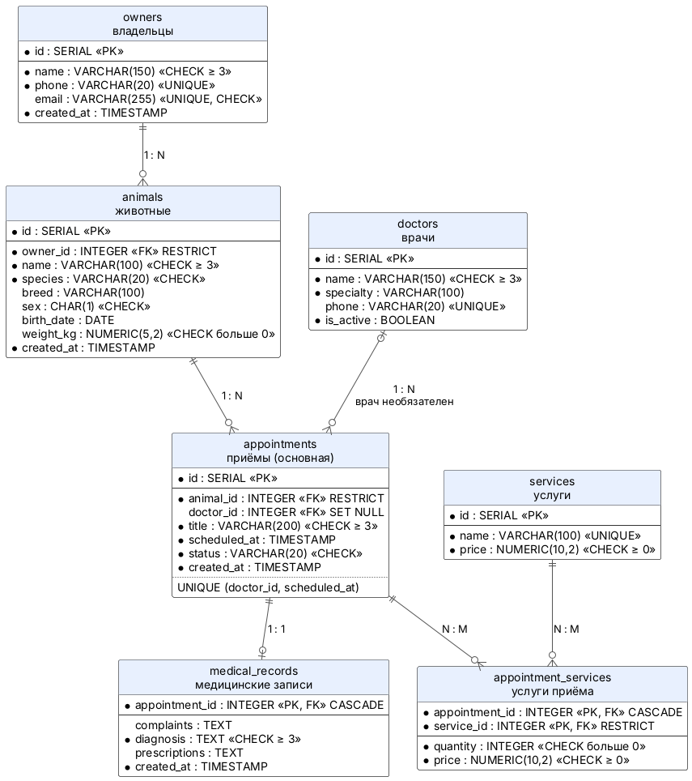

[Исходник](diagrams/src/er.puml). Диаграмма собирается встроенной раскладкой PlantUML, Graphviz не нужен.

### Таблицы

Полный SQL: [sql/01_schema.sql](sql/01_schema.sql).

**owners** — владельцы (ресурс `/api/owners`)

| Поле | Тип | Ограничения | Описание |
|---|---|---|---|
| id | SERIAL | PRIMARY KEY | номер |
| name | VARCHAR(150) | NOT NULL, CHECK (не короче 3) | ФИО |
| phone | VARCHAR(20) | NOT NULL, UNIQUE | телефон |
| email | VARCHAR(255) | UNIQUE, CHECK (есть @) | почта; в API пустая строка, в базе NULL |
| created_at | TIMESTAMP | NOT NULL, DEFAULT NOW() | дата регистрации |

**animals** — животные (ресурс `/api/animals`)

| Поле | Тип | Ограничения | Описание |
|---|---|---|---|
| id | SERIAL | PRIMARY KEY | номер |
| owner_id | INTEGER | NOT NULL, REFERENCES owners ON DELETE RESTRICT | владелец |
| name | VARCHAR(100) | NOT NULL, CHECK (не короче 3) | кличка |
| species | VARCHAR(20) | NOT NULL, DEFAULT 'other', CHECK | dog, cat, bird, rodent, other |
| breed | VARCHAR(100) | | порода |
| sex | CHAR(1) | CHECK | m или f |
| birth_date | DATE | | дата рождения |
| weight_kg | NUMERIC(5,2) | CHECK (больше 0) | вес |
| created_at | TIMESTAMP | NOT NULL, DEFAULT NOW() | дата регистрации |

**doctors** — врачи

| Поле | Тип | Ограничения | Описание |
|---|---|---|---|
| id | SERIAL | PRIMARY KEY | номер |
| name | VARCHAR(150) | NOT NULL, CHECK (не короче 3) | ФИО |
| specialty | VARCHAR(100) | NOT NULL, DEFAULT 'терапевт' | специальность |
| phone | VARCHAR(20) | UNIQUE | телефон |
| is_active | BOOLEAN | NOT NULL, DEFAULT TRUE | работает ли врач |

**appointments** — приёмы, основная сущность (ресурс `/api/appointments`)

| Поле | Тип | Ограничения | Описание |
|---|---|---|---|
| id | SERIAL | PRIMARY KEY | номер |
| animal_id | INTEGER | NOT NULL, REFERENCES animals ON DELETE RESTRICT | животное |
| doctor_id | INTEGER | REFERENCES doctors ON DELETE SET NULL | врач, может быть не назначен |
| title | VARCHAR(200) | NOT NULL, CHECK (не короче 3) | причина обращения |
| scheduled_at | TIMESTAMP | NOT NULL | дата и время приёма |
| status | VARCHAR(20) | NOT NULL, DEFAULT 'scheduled', CHECK | scheduled, done, cancelled |
| created_at | TIMESTAMP | NOT NULL, DEFAULT NOW() | когда создана запись |
| | | UNIQUE (doctor_id, scheduled_at) | у врача один приём в одно время |

**medical_records** — медицинские записи (1:1 с приёмом)

| Поле | Тип | Ограничения | Описание |
|---|---|---|---|
| appointment_id | INTEGER | PRIMARY KEY, REFERENCES appointments ON DELETE CASCADE | приём; первичный и внешний ключ одновременно |
| complaints | TEXT | | жалобы |
| diagnosis | TEXT | NOT NULL, CHECK (не короче 3) | диагноз |
| prescriptions | TEXT | | назначения |
| created_at | TIMESTAMP | NOT NULL, DEFAULT NOW() | дата записи |

**services** и **appointment_services** — услуги и услуги приёма (N:M)

| Таблица | Поле | Тип | Ограничения |
|---|---|---|---|
| services | id | SERIAL | PRIMARY KEY |
| services | name | VARCHAR(100) | NOT NULL, UNIQUE |
| services | price | NUMERIC(10,2) | NOT NULL, CHECK (не меньше 0) |
| appointment_services | appointment_id | INTEGER | REFERENCES appointments ON DELETE CASCADE |
| appointment_services | service_id | INTEGER | REFERENCES services ON DELETE RESTRICT |
| appointment_services | quantity | INTEGER | NOT NULL, DEFAULT 1, CHECK (больше 0) |
| appointment_services | price | NUMERIC(10,2) | NOT NULL, CHECK (не меньше 0) — цена на момент приёма |
| appointment_services | | | PRIMARY KEY (appointment_id, service_id) |

Деньги хранятся в `NUMERIC`, а не в `REAL`: дробные цены не округляются. Цена услуги копируется в приём, потому что прайс может измениться, а выставленный счёт — нет.

Нормализация. В ЛР №7 врач хранился строкой в каждом приёме («Иванова»). Теперь имя врача хранится один раз в `doctors`, а в приёме только `doctor_id`; API в следующей работе подставит имя через JOIN. Услуги приёма не записываются через запятую: каждая пара «приём — услуга» — отдельная строка.

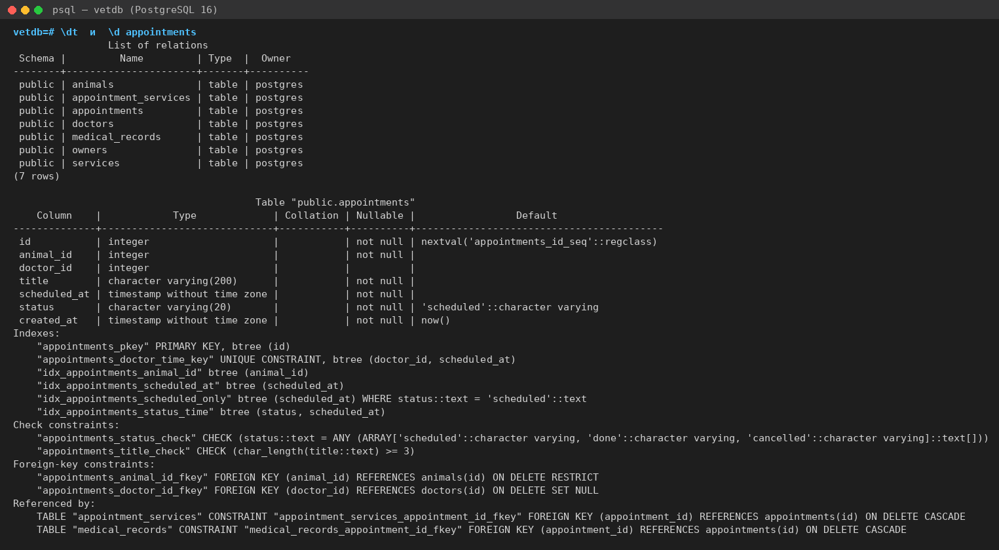

## Связи между сущностями

| Связь | Тип | Как реализована | При удалении главной строки |
|---|---|---|---|
| владелец — животные | 1:N | `animals.owner_id` | запрет, пока есть животные (RESTRICT; в API — 409) |
| животное — приёмы | 1:N | `appointments.animal_id` | запрет, пока есть приёмы (RESTRICT; в API — 409) |
| врач — приёмы | 1:N | `appointments.doctor_id`, может быть NULL | приёмы остаются без врача (SET NULL) |
| приём — медицинская запись | 1:1 | `medical_records.appointment_id` — первичный и внешний ключ | запись удаляется (CASCADE) |
| приёмы — услуги | N:M | связующая таблица `appointment_services`, составной первичный ключ | строки приёма удаляются (CASCADE); оказанную услугу удалить нельзя (RESTRICT) |

### Проверка ссылочной целостности

[sql/03_integrity.sql](sql/03_integrity.sql) пытается нарушить каждое правило. Все 12 неверных запросов отклонены, CASCADE и SET NULL сработали внутри транзакции с ROLLBACK, данные не изменились.

| № | Что пытаемся сделать | Ответ PostgreSQL |
|---|---|---|
| 1 | приём животного № 99 | violates foreign key constraint "appointments_animal_id_fkey" |
| 2 | статус finished | violates check constraint "appointments_status_check" |
| 3 | причина «Да» | violates check constraint "appointments_title_check" |
| 4 | приём без даты | null value in column "scheduled_at" ... violates not-null constraint |
| 5 | второй владелец с телефоном +79000000001 | violates unique constraint "owners_phone_key" |
| 6 | второй приём у Ивановой 2026-11-01 10:00 | violates unique constraint "appointments_doctor_time_key" |
| 7 | вторая медзапись к приёму № 2 (1:1) | violates unique constraint "medical_records_pkey" |
| 8 | та же услуга в приёме № 2 повторно (N:M) | violates unique constraint "appointment_services_pkey" |
| 9 | цена -100 | violates check constraint "services_price_check" |
| 10 | удалить владельца № 1 с животными | violates foreign key constraint "animals_owner_id_fkey" |
| 11 | удалить животное № 1 с приёмами | violates foreign key constraint "appointments_animal_id_fkey" |
| 12 | удалить оказанную услугу | violates foreign key constraint "appointment_services_service_id_fkey" |
| 13 | удалить приём № 5 | медзапись и 2 услуги удалились вместе с ним (CASCADE) |
| 14 | удалить врача Петрова | у приёмов 2, 4, 6 doctor_id стал NULL (SET NULL) |

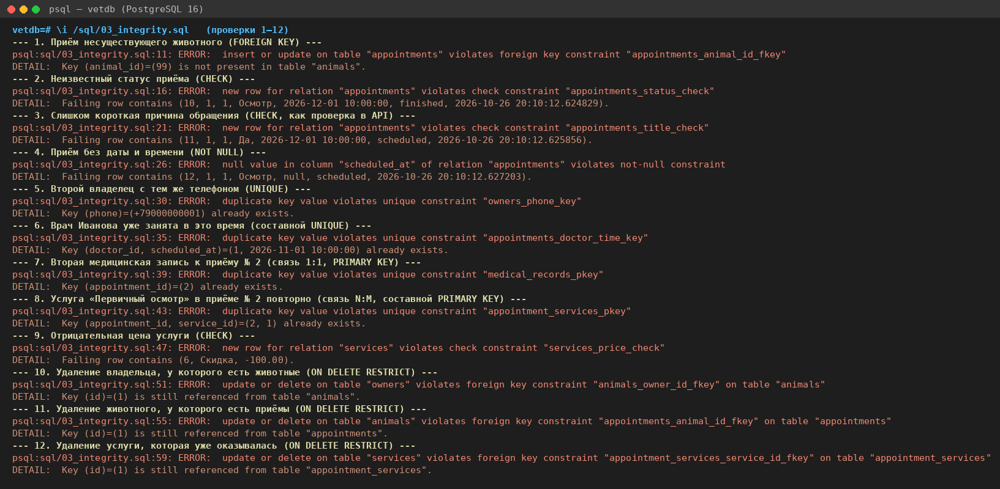

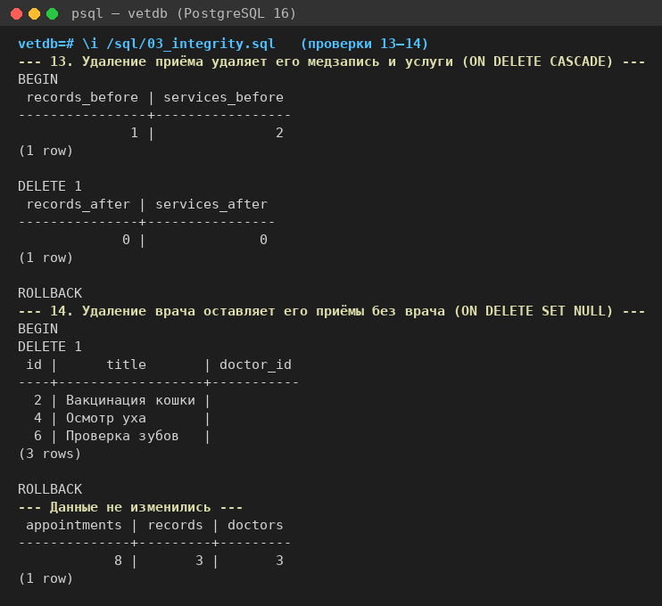

## Примеры SQL-запросов

Все запросы: [sql/04_crud.sql](sql/04_crud.sql). Они покрывают все методы API ЛР №7 для приёмов, животных и владельцев.

| Операция | REST API | SQL |
|---|---|---|
| Create | POST /api/appointments | `INSERT INTO appointments (...) VALUES (...) RETURNING id` |
| Read (список) | GET /api/appointments?status=scheduled&animal_id=1 | `SELECT ... WHERE status = 'scheduled' AND animal_id = 1 ORDER BY scheduled_at` |
| Read (поиск) | GET /api/appointments?q=осмотр | `SELECT ... WHERE title ILIKE '%осмотр%'` |
| Read (одна) | GET /api/appointments/1 | `SELECT ... FROM appointments a LEFT JOIN doctors d ... WHERE a.id = 1` |
| Read (связь) | GET /api/animals/2/appointments | `SELECT ... WHERE animal_id = 2` |
| Update | PATCH /api/appointments/{id} | `UPDATE appointments SET scheduled_at = scheduled_at + INTERVAL '1 day' WHERE id = ...` |
| Delete | DELETE /api/appointments/{id} | `DELETE FROM appointments WHERE id = ... RETURNING id` |

Новый приём получает номер 14, а не 9: номера 9–13 израсходованы на пять неудачных вставок в 03_integrity.sql. SERIAL не возвращает номера, пропуски нормальны.

Приём в формате API ЛР №7. Имя врача подставляется LEFT JOIN, дата приводится к виду 2026-11-01T10:00:

```sql
SELECT a.id, a.animal_id, a.title, d.name AS doctor,
       to_char(a.scheduled_at, 'YYYY-MM-DD"T"HH24:MI') AS date, a.status
FROM appointments a
LEFT JOIN doctors d ON d.id = a.doctor_id
WHERE a.id = 1;
```

Журнал приёмов. Животное и владелец у приёма есть всегда — JOIN; врач может быть не назначен — LEFT JOIN, иначе приём № 7 пропадёт:

```sql
SELECT a.id, a.scheduled_at, an.name AS animal, o.name AS owner,
       d.name AS doctor, a.title, a.status
FROM appointments a
JOIN animals an     ON an.id = a.animal_id
JOIN owners o       ON o.id = an.owner_id
LEFT JOIN doctors d ON d.id = a.doctor_id
ORDER BY a.scheduled_at;
```

Счёт приёма (связь N:M):

```sql
SELECT a.id, a.title,
       string_agg(s.name || ' ×' || x.quantity, ', ' ORDER BY s.name) AS services,
       SUM(x.quantity * x.price) AS total
FROM appointments a
JOIN appointment_services x ON x.appointment_id = a.id
JOIN services s             ON s.id = x.service_id
GROUP BY a.id, a.title
ORDER BY a.id;
```

Отчёт руководителя (GROUP BY). LEFT JOIN оставляет в отчёте врачей без приёмов; выручка считается подзапросом, чтобы JOIN с услугами не размножал строки приёмов:

```sql
SELECT d.name, d.specialty,
       COUNT(a.id)                                       AS total,
       COUNT(a.id) FILTER (WHERE a.status = 'done')      AS done,
       COUNT(a.id) FILTER (WHERE a.status = 'scheduled') AS scheduled,
       COALESCE(SUM((SELECT SUM(x.quantity * x.price)
                     FROM appointment_services x
                     WHERE x.appointment_id = a.id)) FILTER (WHERE a.status = 'done'), 0) AS revenue
FROM doctors d
LEFT JOIN appointments a ON a.doctor_id = d.id
GROUP BY d.id, d.name, d.specialty
ORDER BY d.id;
```

Изменение и удаление. Перед ними выполняется SELECT с тем же WHERE:

```sql
UPDATE appointments SET status = 'done' WHERE id = :appointment_id RETURNING id, status;
DELETE FROM appointments WHERE id = :appointment_id RETURNING id, title;  -- медзапись и услуги удалятся каскадом
DELETE FROM appointments WHERE id = :appointment_id;                      -- DELETE 0, в API — 404
```

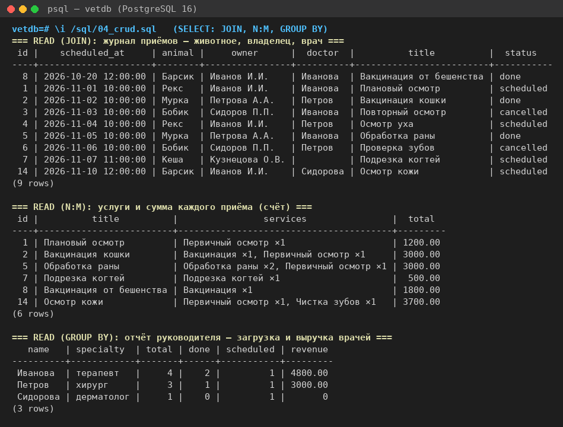

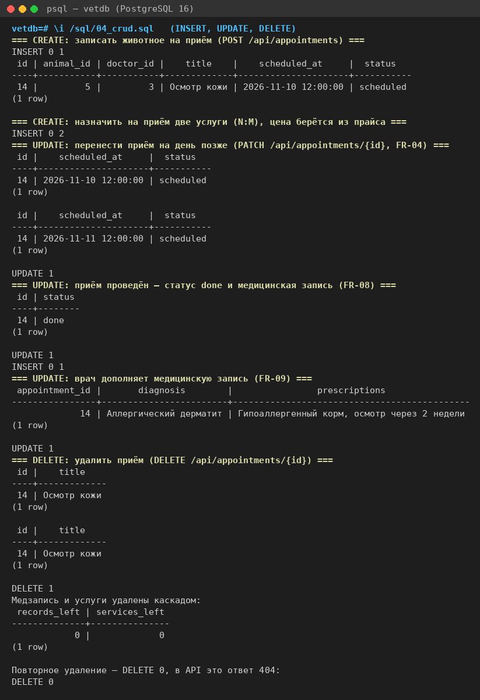

## Результаты оптимизации запросов

[sql/05_test_data.sql](sql/05_test_data.sql) добавляет 50 врачей, 100 000 владельцев, 150 000 животных, 500 000 приёмов, около 300 000 медицинских записей и 450 000 строк услуг. [sql/06_optimization.sql](sql/06_optimization.sql) выполняет EXPLAIN ANALYZE до индекса и после. Полные планы и разбор: [docs/optimization.md](docs/optimization.md).

| № | Запрос | Индекс | План до | План после | До, мс | После, мс | Ускорение |
|---|---|---|---|---|---:|---:|---:|
| 1 | история приёмов животного (`animal_id = 1234`) | appointments (animal_id) | Parallel Seq Scan | Bitmap Index Scan | 47,3 | 0,09 | ×509 |
| 2 | животные владельца (`owner_id = 777`) | animals (owner_id) | Seq Scan | Bitmap Index Scan | 13,1 | 0,08 | ×158 |
| 3 | 20 ближайших запланированных приёмов | appointments (status, scheduled_at) | Parallel Seq Scan + Sort | Index Scan, без Sort | 40,1 | 0,07 | ×590 |
| 4 | расписание клиники на день | appointments (scheduled_at) | Bitmap Index Scan по всему составному индексу | Index Scan | 5,2 | 0,71 | ×7 |

Время одного прогона на PostgreSQL 16.15; на другом компьютере числа будут другими, важно соотношение.

Наблюдения:

- PostgreSQL не создаёт индексы для внешних ключей сам, поэтому запросы 1 и 2 перебирали таблицу целиком: в запросе 1 каждый из трёх процессов отбросил по 166 668 строк ради трёх нужных;
- в запросе 3 строки в индексе уже лежат по времени, поэтому из плана исчез Sort: база читает 20 записей и останавливается;
- в запросе 4 составные индексы со столбцом `scheduled_at` уже были, но в них он стоит вторым, и базе пришлось просматривать индекс целиком. Отдельный индекс ускорил запрос ещё в 7 раз;
- расписание одного врача на день быстрое без нового индекса: `UNIQUE (doctor_id, scheduled_at)` сам создал индекс, а условие идёт по его первому столбцу (0,09 мс);
- индекс не помогает, если условию подходит большая часть таблицы (отчёт по проведённым приёмам — 60% строк, Parallel Seq Scan, 81 мс) и при поиске подстроки `LIKE '%0012345%'` (Seq Scan по 100 005 владельцам, 24 мс);
- у индексов есть цена: три новых индекса на `appointments` занимают около 15 МБ, а вставка 50 000 приёмов с ними заняла 832 мс против 555 мс без них.

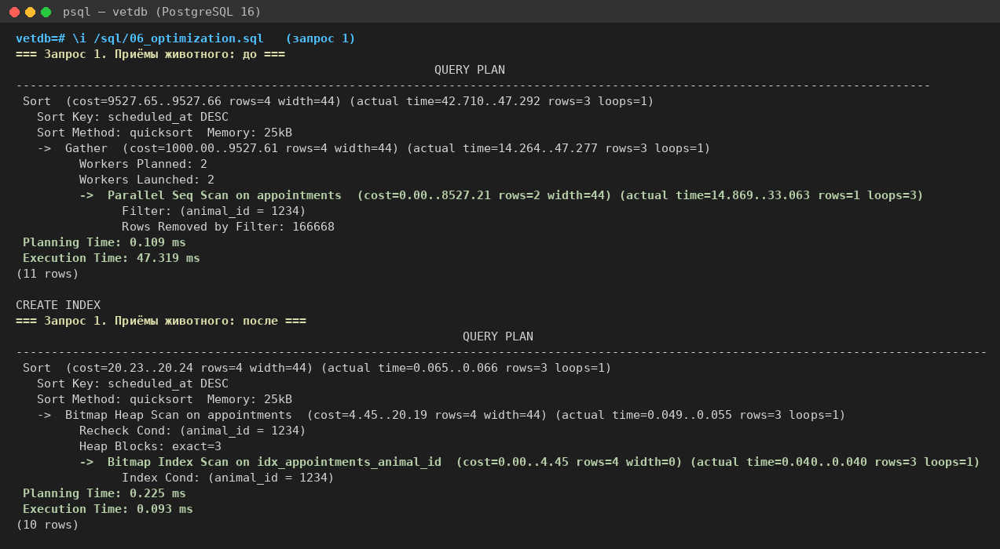

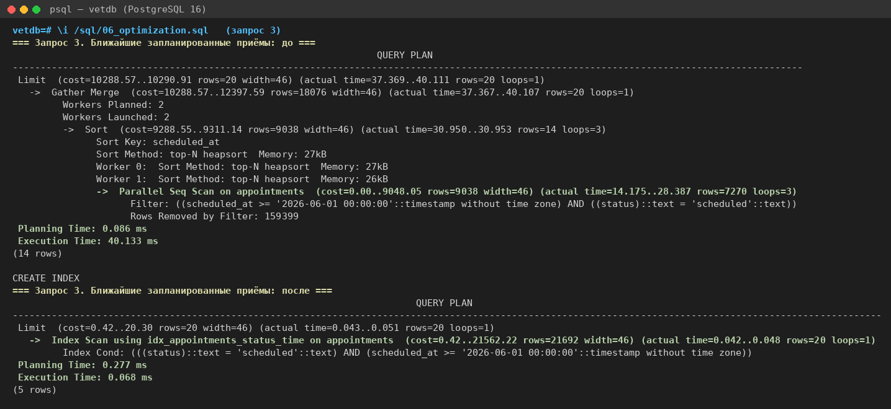

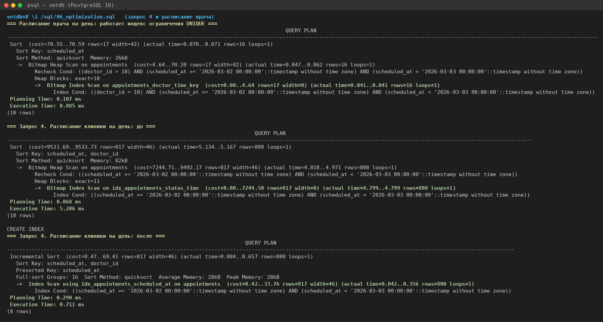

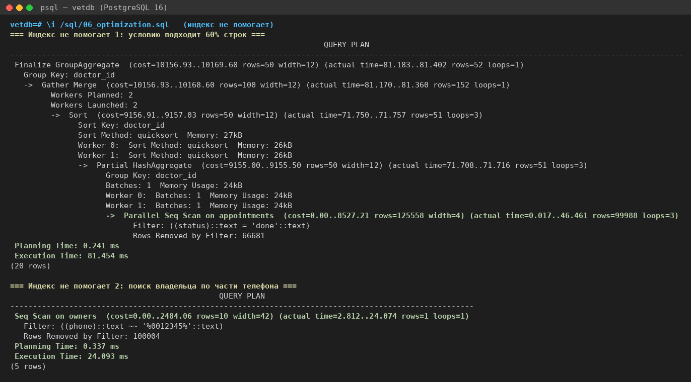

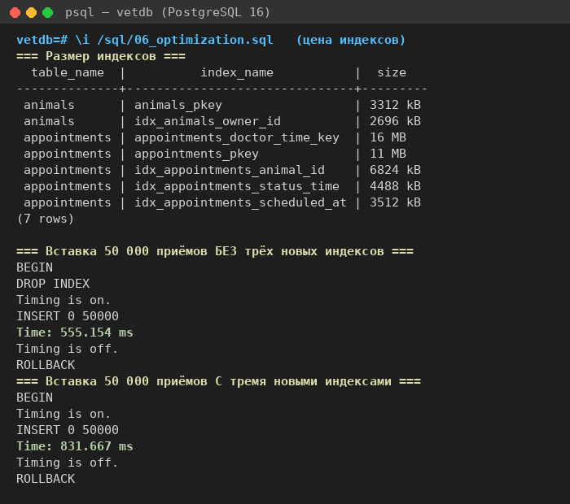

## Повышенная сложность

[sql/07_advanced.sql](sql/07_advanced.sql):

- поиск владельца по части телефона: расширение `pg_trgm` и индекс `USING gin (phone gin_trgm_ops)`. План сменился с Seq Scan на Bitmap Index Scan, время — с 21,4 до 0,23 мс;
- частичный индекс `ON appointments (scheduled_at) WHERE status = 'scheduled'`: 1088 kB против 6472 kB у составного `(status, scheduled_at)`, запрос 3 обслуживает так же (0,06 мс). Индексы к этому моменту выросли после проверочных вставок в 06_optimization.sql: ROLLBACK отменяет данные, но не уменьшает файлы;
- представление `doctor_workload` — отчёт руководителя о загрузке и выручке врачей;
- транзакция «врач увольняется — его запланированные приёмы переходят другому врачу». Если у второго врача те же часы заняты, срабатывает UNIQUE, и отменяется вся транзакция, в том числе уже выполненный первый шаг;
- пользователь `vet_app` для приложения: только SELECT, INSERT, UPDATE, DELETE. Попытка `DROP TABLE` от его имени отклонена.

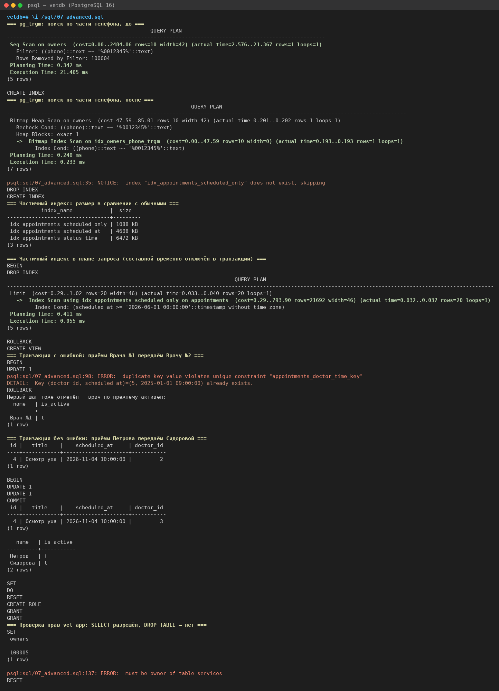

## Проверка

Все скрипты выполнены по порядку 01 → 07 на пустой базе PostgreSQL 16.15. Снимки в images/ сделаны из вывода psql этого прогона. Прогон также настроен во вкладке Actions репозитория: скрипты выполняются на чистой базе, число ошибок сверяется с ожидаемым, вывод сохраняется в архив lab8-results.

## Вывод

Спроектирована и реализована база данных ветеринарной клиники: 7 таблиц, связи 1:1, 1:N и N:M, ограничения целостности. Правила, которые в ЛР №7 проверял PHP-код (допустимый статус, длина причины, существование животного, запрет удалить животное с приёмами), теперь проверяет сама база для любой программы. Добавлено правило, которого не было в API: у врача не может быть двух приёмов в одно время. CRUD-запросы соответствуют методам API и будут использованы при подключении базы к серверной части. На 500 000 приёмов индексы по внешним ключам и столбцам фильтрации и сортировки ускорили частые запросы в 7–590 раз. Они не помогают запросам, которые читают большую часть таблицы, и замедляют запись, поэтому каждый индекс проверяется планом EXPLAIN ANALYZE.

## Структура

```
lab8/
├── README.md
├── docker-compose.yml        PostgreSQL 16, база vetdb
├── sql/
│   ├── 01_schema.sql         таблицы и ограничения
│   ├── 02_seed.sql           исходные данные
│   ├── 03_integrity.sql      проверка ограничений и связей
│   ├── 04_crud.sql           CRUD-операции
│   ├── 05_test_data.sql      большой объём данных
│   ├── 06_optimization.sql   EXPLAIN ANALYZE до и после индексов
│   └── 07_advanced.sql       повышенная сложность
├── diagrams/
│   ├── src/er.puml           ER-диаграмма (PlantUML)
│   └── images/er.png
├── images/                   снимки выполнения скриптов
└── docs/optimization.md      полные планы выполнения
```
